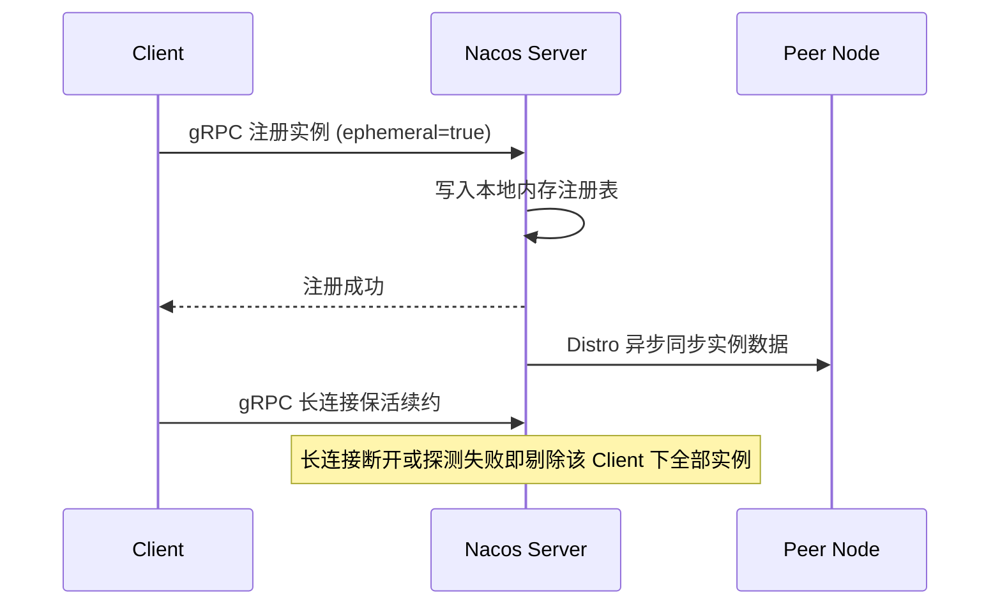
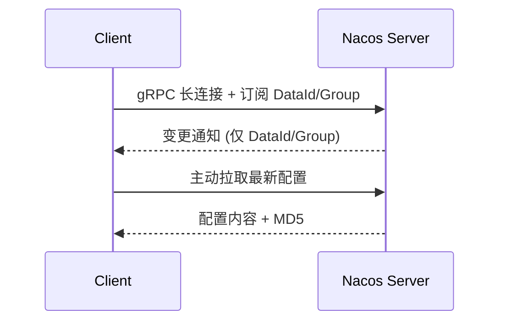
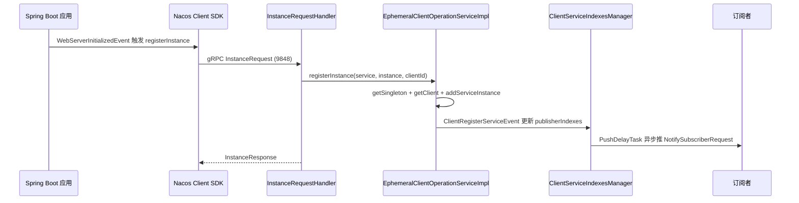

# Spring Cloud Alibaba · Nacos 注册中心与配置中心

> 一句话定位：面试问 Nacos，真正想听的是「它凭什么同时做注册中心和配置中心」以及「服务变更、配置变更到底怎么传到客户端」。  
> 版本前提：Nacos **3.2.4**（2026-08 最新稳定，要求 JDK 17）；2.x 线为 **2.5.4**（JDK 8）。Spring Cloud Alibaba **2025.1.0.0** 对应 Nacos **3.1.1**。

## 1. 是什么

Nacos（Dynamic Naming and Configuration Service）是阿里开源的注册中心 + 配置中心二合一组件。2.x 起客户端与服务端改用 gRPC 长连接（客户端端口 **9848**，Server 节点间 **9849**），**8848** 仍保留给控制台和 OpenAPI。它同时维护两类数据：服务实例清单（地址、权重、元数据、健康状态）和配置（Namespace / Group / DataId 下的内容）。

## 2. 为什么这样设计

单体时代配置写在本地文件，改一次重启一次；服务地址写死在代码里，扩缩容就要改配置。注册中心解决「实例地址动态变化」，配置中心解决「配置集中管理、动态生效」。

对比其他注册中心，Nacos 的取舍很清楚：

| 组件        | CAP             | 配置中心        | 健康检查             | 主要代价                |
| --------- | --------------- | ----------- | ---------------- | ------------------- |
| Eureka    | **AP**          | 无           | 客户端心跳            | 长期维护模式，注册表最终一致      |
| ZooKeeper | **CP**          | 可借 ZNode 实现 | 会话 + 临时节点        | 选主期间不可用，Watch 有羊群效应 |
| Consul    | **CP**          | 有           | TCP/HTTP/gRPC 探测 | 国内生态一般，Raft 写有延迟    |
| Nacos     | **AP + CP 可切换** | 内置          | 心跳 / 主动探测        | 组件更重，要维护 gRPC 端口与集群 |

Nacos 不追求「一种协议打天下」，而是按数据类型拆协议：**临时实例走 AP，持久实例和配置走 CP**。这就是它同时做两件事还不塌的原因。

## 3. 底层怎么实现

### 3.1 服务注册、健康检查与变更通知

实例分两类，两类数据都是在**同一个 Nacos Server 集群内部的各节点之间**同步（走 9849 等节点间端口，既不是服务实例集群与 Nacos 集群之间的 9848 客户端通道，也不是两个不同 Nacos 集群之间互相同步），区别只在于按**数据类型**分了 AP / CP 两条协议通道。

临时实例（`ephemeral=true`，默认）只存各节点内存，由客户端保活续约，1.x 口径是每 **5s** 发独立 HTTP 心跳、服务端 **15s** 未续约标记不健康、**30s** 剔除，**2.x 起**换成 **gRPC 长连接保活**、服务端看连接活跃状态判断存活、断连剔除更快；节点间用 **Distro 协议（AP）**&#x5F02;步分发。

持久实例（`ephemeral=false`）在集群外置库模式下落 MySQL（3.x 也可用内置分布式存储，不必外置），由服务端主动做 TCP/HTTP 探测；节点间用 **JRaft（CP）**&#x4FDD;证强一致。2.x 起这个属性属于 `Service` 而不是单个实例，服务名第一次写入时定死类型，之后写入另一类实例会被服务端拒绝并报 `Current service xxx is ephemeral service, can't register persistent instance.`，机制见 3.4.6。

1. **持久实例的元数据文件**：路径 {user.home}/nacos/data/naming/data/{namespaceId}（对于 public 命名空间，就是 .../naming/data/public）。这里面存储的是服务端为了管理持久实例而序列化到磁盘上的**元数据文件**，可以理解为服务端自身的一份“本地文件存档”。
2. **内置 Derby 数据库文件**：Nacos 默认使用的嵌入式数据库是 Apache Derby，它的数据文件存放在另一个独立的目录，通常是 **${nacos.home}/data/derby-data**。像配置信息等需要持久化到数据库中的数据，最终会写入这里

同一集群里 AP 与 CP 并存，正是第 2 节「临时实例走 AP，持久实例和配置走 CP」的落地，两条通道的差异逐项对照如下：

| 对比维度   | 第一处：临时实例                                                         | 第二处：持久实例                             |
| ------ | ---------------------------------------------------------------- | ------------------------------------ |
| 同步什么   | 临时实例注册表（各节点内存）                                                   | 持久实例数据，配置数据同走这条                      |
| 协议     | **Distro**（阿里自研，AP）                                              | **JRaft / SOFA-JRaft**（Raft，CP）      |
| 拓扑     | 无主，各节点平等，按实例 hash 分片各负责一部分数据的写                                   | **有 Leader，写必须由 Leader 处理**          |
| 怎么复制   | 写落到**责任节点**（非责任节点转发），本地写完**异步批量**推给其他节点，定期校验 checksum，不一致就全量拉取补齐 | Raft 日志复制到**多数派**才提交，再 apply 到状态机/落库 |
| 分区时    | 各节点照常读写，恢复后最终一致                                                  | 未过半的节点不可写，选主期间短暂不可写                  |
| 为什么这么选 | 临时实例有客户端保活与重注册能自动补数据，短暂不一致可容忍，可用性优先                              | 数据由服务端创建、没有客户端帮忙补，不能丢也不能分叉，一致性优先     |



服务变更怎么通知客户端：注册、下线、权重变化都会在服务端产生 **Naming 事件**，服务端通过已建立的 gRPC 长连接向订阅了该服务的客户端推送变更，客户端更新本地缓存。集群内另一节点收到写请求时，先按 client IP/port（2.x 即 clientId，1.x 按服务名）hash 出责任节点，不属于自己就转发，再由 Distro 异步复制。这条链路每一步对应的源码类与方法见 3.4.2。

### 3.2 配置中心与变更通信

配置按 Namespace（环境）→ Group（业务线）→ DataId（应用/文件） 三级隔离。客户端启动时拉取配置并落本地快照（**`~/nacos/config`**），Nacos 不可用时优先读快照。

变更通知经历了两代：

- **Nacos 1.x：HTTP 长轮询**。客户端**每隔 30 秒**向服务端发起一次长轮询请求，每次请求服务端 持续（hold） 时间约 **29.5s**（客户端 30s 超时重发），期间配置变更立即响应；**客户端拿到变更的 `DataId + Group` 后再拉内容**。用 MD5 对比减少无效传输。(**削峰设计**)

  **1.服务端返回变更列表**：长轮询连接被触发后，服务端返回的响应体是一个纯文本字符串，内容为发生变更的配置标识列表。每一行代表一个变更项，格式通常为 `dataId^2group^2tenant`（用换行符分隔）。

  **2.客户端解析并逐个拉取**：客户端（`ClientWorker`）解析这个列表，得到具体的 `dataId`、`group`、`tenant`，然后**针对每一个变更项，单独发起 `getServerConfig` 请求**，去获取完整的配置内容。

  **3.更新本地缓存与触发回调**：客户端拿到新内容后，更新本地内存缓存和快照文件，并计算新的 MD5 值。随后触发注册在该配置上的监听器（Listener）回调，完成动态刷新
- **Nacos 2.x / 3.x：gRPC 双向流**。服务端主动推 `ConfigChangeNotifyRequest`，只带 DataId、Group、lastModified，不带配置内容；客户端收到通知后自己拉最新内容。这是「推拉结合」：推负责实时，拉负责内容一致与带宽可控。

<span style="color:rgb(222, 60, 54)">3.x 的 Client OpenAPI 不再提供 HTTP 长轮询监听，配置监听必须走官方 SDK 的 gRPC 长连接</span>。只开 8848 不开 9848，<span style="color:rgb(222, 60, 54)">注册和监听都会失败</span>。



### 3.3 一致性协议分工

| 数据类型 | 协议        | 一致性        | 存储    |
| ---- | --------- | ---------- | ----- |
| 临时实例 | Distro    | AP，最终一致    | 各节点内存 |
| 持久实例 | **JRaft** | **CP，强一致** | MySQL |
| 配置   | JRaft     | CP，强一致     | MySQL |

生产部署至少 **3 节点（奇数）**，外置库模式下共用 MySQL（3.x 也可用内置分布式存储，不必外置，但仍要靠 JRaft 在节点间复制日志保证强一致）；节点数少于 3 时 Raft 无法选举。


### 3.4 一次注册请求的完整链路（2.x / 3.x）

主线：Spring Boot 应用在 Web 容器就绪时经 Spring Cloud Common 的 **`ServiceRegistry`** 发起注册，客户端把 `InstanceRequest` 通过 gRPC 长连接（9848）发到 Nacos服务器，服务端把实例挂到这条连接对应的 `Client（`存储该客户端发布了哪些服务、订阅了哪些服务`）` 上并更新索引，再靠事件驱动把变更推给订阅者，最后由 Distro 在集群内按 client 维度同步。3.x 沿用这条链路。

#### 3.4.1 客户端侧：谁发起注册

Spring Cloud 应用不会手写 `NacosFactory.createNamingService()`。真正的入口是自动装配：

| 环节   | 类 / 事件                                                                             | 动作                                                                                                                                                                 |
| ---- | ---------------------------------------------------------------------------------- | ------------------------------------------------------------------------------------------------------------------------------------------------------------------ |
| 自动装配 | `NacosServiceRegistryAutoConfiguration`                                            | 注册 `NacosAutoServiceRegistration`、`NacosServiceRegistry`、`NacosRegistration`，分别对应 Spring Cloud Common 的 `AutoServiceRegistration`、`ServiceRegistry`、`Registration` |
| 触发时机 | `WebServerInitializedEvent`                                                        | `AbstractAutoServiceRegistration` 实现 `ApplicationListener`，Web 容器初始化完成后回调 `bind()` → `start()`                                                                     |
| 组装信息 | `NacosRegistration` / `NacosDiscoveryProperties`                                   | 服务名、IP、端口、权重、cluster、group、namespace、metadata、ephemeral                                                                                                            |
| 调用注册 | `NacosServiceRegistry.register(Registration)` → `NamingService.registerInstance()` | 进入 nacos-client                                                                                                                                                    |
| 选通道  | `NamingClientProxyDelegate`                                                        | 临时实例走 gRPC `NamingGrpcClientProxy`，持久实例走 HTTP `NamingHttpClientProxy`；`InstanceRequestHandler` 里 `Service.newService(..., true)` 写死，9848 这条链路上只有临时实例               |
| 发请求  | `InstanceRequest` + `RequestMeta.connectionId`                                     | 通过已建立的 gRPC 长连接发到 9848，失败后客户端换节点重试，重连后由 Redo 机制重做未确认的注册                                                                                                            |

`server-addr` 仍填 **8848**，客户端 SDK 内部按 8848 + 1000 换算出 gRPC 端口 9848，节点间是 9849，所以配置里写 8848 不等于注册走 HTTP。3.x 部署默认要求配置鉴权参数（如 `NACOS_AUTH_TOKEN`），服务端开启鉴权后只传 `SERVER_ADDR` 的示例会拿到 403，需要补 `PropertyKeyConst.USERNAME` / `PASSWORD`（SDK 自动换 accessToken）或直接传 accessToken。

原生 SDK 的最小示例（可直接编译，空格与 import 已补齐，3.x 需补账号）：

```java
import com.alibaba.nacos.api.NacosFactory;
import com.alibaba.nacos.api.PropertyKeyConst;
import com.alibaba.nacos.api.exception.NacosException;
import com.alibaba.nacos.api.naming.NamingService;
import com.alibaba.nacos.api.naming.pojo.Instance;
import java.util.HashMap;
import java.util.Map;
import java.util.Properties;

public class NacosServiceRegisterDemo {
    public static void main(String[] args) throws NacosException {
        Properties properties = new Properties();
        properties.put(PropertyKeyConst.SERVER_ADDR, "127.0.0.1:8848");
        properties.put(PropertyKeyConst.USERNAME, "nacos");
        properties.put(PropertyKeyConst.PASSWORD, "your-password");

        Instance instance = new Instance();
        instance.setIp("1.1.1.1");
        instance.setPort(800);
        instance.setWeight(2);
        Map<String, String> metadata = new HashMap<>();
        metadata.put("netType", "external");
        metadata.put("version", "2.0");
        instance.setMetadata(metadata);

        NamingService namingService = NacosFactory.createNamingService(properties);
        namingService.registerInstance("nacos.test.1", instance);
    }
}
```

这段代码演示的是「手动用 SDK 注册一个实例」，不是 Spring Boot 应用的注册方式，更不是服务端流程。

#### 3.4.2 服务端侧：请求怎么落到注册表

1. `InstanceRequestHandler.handle(InstanceRequest, RequestMeta)` 是 gRPC 注册与注销的统一入口，带 `@Secured(action = WRITE)` 做写权限校验，用 namespace、group、serviceName 构造 `Service`，再按 `request.getType()` 分流到注册或注销分支。
2. `EphemeralClientOperationServiceImpl.registerInstance(service, instance, clientId)` 是临时实例的落地方法。持久实例不走这条内存链路，由 JRaft(CP) 复制到多数派才提交，分工见 3.3。
3. `ServiceManager.getInstance().getSingleton(service)` 只保证 `Service` 单例存在。**2.x 的 ServiceManager 不再存实例**，Service 重写 `equals/hashCode` 直接作为 Map 的 key，这点和 1.x 完全不同。
4. `ClientManager.getClient(clientId)` 取到建连时就放进 `ConnectionBasedClientManager` 的 `ConnectionBasedClient`。一条 gRPC 长连接对应一个 Client，实例挂在 Client 上；`getPublishInfo(instance)` 把客户端 `Instance` 转成服务端 `InstancePublishInfo`。
5. `client.addServiceInstance(singleton, instanceInfo)` 加入实例并 `setLastUpdatedTime()`。同一 clientId 重复注册同一服务属于更新而非新增，天然幂等。
6. `NotifyCenter.publishEvent(new ClientOperationEvent.ClientRegisterServiceEvent(...))` 广播事件，`ClientServiceIndexesManager` 监听后维护 `publisherIndexes`（Service 到 clientId 集合）与 `subscriberIndexes`；随后发出 `ServiceEvent.ServiceChangedEvent`，`NamingSubscriberServiceV2Impl` 生成 `PushDelayTask`，由 `PushDelayTaskExecuteEngine` 异步把实例列表推给订阅该服务的客户端。3.1 讲的变更通知就是这一步。



集群侧还有一层：客户端随机选一个节点发请求，收到请求的节点用 `DistroMapper.mapSrv()` 按 hash 判断责任节点（1.x 按服务名，2.x 按 client IP:port），不是自己就转发；责任节点写完本地 Client 数据后，Distro 把 `ClientSyncData` 异步同步给其他节点，并定期用 checksum 校验、不一致就全量补齐。这就是 3.1 表格里 Distro(AP) 那条通道的具体实现。

#### 3.4.3 1.x 与 2.x/3.x 的模型差异

| 维度             | 1.x                                             | 2.x / 3.x                                                              |
| -------------- | ----------------------------------------------- | ---------------------------------------------------------------------- |
| 传输             | HTTP 短连接，8848                                   | gRPC 长连接，9848                                                          |
| 服务端入口          | `InstanceController.register()`                 | `InstanceRequestHandler.handle()`                                      |
| 注册表模型          | `ServiceManager` → Service → Cluster → Instance | `ConnectionBasedClient` + `ClientServiceIndexesManager` 索引             |
| Service 与实例的关系 | 实例直接挂在 Service 的 Cluster 下                      | 实例挂在 Client 上，Service 到 clientId 的索引由 `ClientServiceIndexesManager` 维护 |
| 变更推送           | UDP 推送 + 客户端拉取                                  | gRPC 长连接推 `NotifySubscriberRequest`                                    |
| 临时实例保活         | 客户端每 5s HTTP 心跳，15s 不健康、30s 剔除                  | 长连接活跃状态 + 服务端 3s 定时探测                                                  |

`InstanceController` 在 2.x/3.x 仍保留（另有 `InstanceControllerV2`），但只用于兼容 1.x / v2 的 HTTP OpenAPI，不是 gRPC 注册主链路。面试里把「服务端注册入口」答成 `InstanceController.register()`，等于按 1.x 作答。各容器的字段类型、读写分离与相互关系见 3.4.6。

#### 3.4.4 注册之后的保活与剔除

临时实例的存活绑在长连接上：`ConnectionManager` 每 **3s** 扫一次，对超过 **20s** 没有任何通讯的连接发 `ClientDetectionRequest`，**1s** 内没响应就 `unregister` 断开连接，连接对应的 `ConnectionBasedClient` 被清理、它下面注册的所有实例一起从索引中移除并触发变更推送；`ConnectionBasedClient.isExpire()` 只针对从其他节点同步来的非 native Client 做过期判定，由 `ExpiredClientCleaner` 定时清理。所以 2.x 没有「每 5s 发一次 HTTP 心跳包」，也没有 1.x 那种「先置 healthy=false 再剔除」的中间态，断连就是整批剔除。

持久实例不走这套：由服务端主动做 TCP / HTTP / MySQL 探测，探测失败只标记不健康，**不会从注册表删除**（对应 3.1 表格里「数据由服务端创建、没有客户端帮忙补」）。两类实例的保活机制不能混着讲。

#### 3.4.5 原文勘误速查

| 原文说法                                         | 问题                                         | 正解                                                                                                 |
| -------------------------------------------- | ------------------------------------------ | -------------------------------------------------------------------------------------------------- |
| 「服务端注册核心逻辑在 `InstanceController.register()`」 | 1.x HTTP 口径                                | 2.x/3.x 主链路是 `InstanceRequestHandler` → `EphemeralClientOperationServiceImpl`，见 3.4.2              |
| 「`ServiceManager` 把实例存进内部注册表并触发事件通知」         | 2.x 里它只管 Service 单例                        | 实例存在 `ConnectionBasedClient`，索引由 `ClientServiceIndexesManager` 维护，事件是 `ClientRegisterServiceEvent` |
| 「实例定期发送心跳包，长时间未发送就标记不健康或移除」                  | 把 1.x 与两类实例混为一谈                            | 2.x 临时实例靠长连接保活，持久实例由服务端主动探测且不删除，见 3.4.4                                                            |
| 「不健康的实例会从服务注册表中移除」                           | 不准确                                        | 标记不健康不等于剔除，持久实例不会因不健康被删                                                                            |
| 「通过 `server-addr` 连接服务器」配 8848               | 容易误读成注册走 8848 HTTP                         | 8848 是控制台/OpenAPI，SDK 换算后用 9848 gRPC；3.x 还要补账号，否则 403                                              |
| 示例代码 `publicclassNacosServiceRegisterDemo` 等 | 复制时空格丢失、缺 `PropertyKeyConst` 的 import，无法编译 | 可编译版本见 3.4.1                                                                                       |
| 标题「服务端注册源码流程」                                | 四节里三节是客户端 SDK 代码，服务端只有两个类名                 | 完整链路见 3.4.1 到 3.4.4，含集群转发、事件与推送                                                                    |
| 「一个服务下可以同时有临时实例和持久实例」                        | 1.x 口径                                     | 2.x 起类型提升到 Service 层级，同一 Service 不能混用，见 3.4.6                                                      |

#### 3.4.6 临时实例的内存存储结构（2.x / 3.x）

2.x 起临时实例不再挂在 `Service` 下面，实例本体只存在于 `Client` 对象里。服务端内存由四个并列的组件各自持有一组容器，不是层层嵌套的一张注册表：写操作改前两层，读操作走第四层，第三层只提供作为 key 的 `Service` 单例。1.x 的 `Service → Cluster → Set<Instance>` 层次模型被整体替换，驱动力是 gRPC 长连接要求实例生命周期直接绑定到连接上。常听到的「双向索引」只描述了数据方向，容易让人误以为是一张自包含的结构，实际两个 Map 分属不同组件，靠事件保持一致。

```text
ConnectionBasedClientManager        实例数据的唯一持有者
  clients : ConcurrentMap<String, ConnectionBasedClient>       key = clientId = connectionId
    AbstractClient
      publishers  : ConcurrentHashMap<Service, InstancePublishInfo>   实例本体
      subscribers : ConcurrentHashMap<Service, Subscriber>

ClientServiceIndexesManager         反向索引，不存实例
  publisherIndexes  : ConcurrentMap<Service, Set<String>>    Service → Set<clientId>
  subscriberIndexes : ConcurrentMap<Service, Set<String>>   Service → Set<clientId>

ServiceManager                      静态单例，只管 Service 对象
  singletonRepository    : ConcurrentHashMap<Service, Service>
  namespaceSingletonMaps : ConcurrentHashMap<String, Set<Service>>

ServiceStorage                      读缓存（物化视图）
  serviceDataIndexes  : ConcurrentMap<Service, ServiceInfo>
  serviceClusterIndex : ConcurrentMap<Service, Set<String>>

NamingMetadataManager               运维态元数据，与实例分开存
  serviceMetadataMap  : ConcurrentMap<Service, ServiceMetadata>
  instanceMetadataMap : ConcurrentMap<Service, ConcurrentMap<String, InstanceMetadata>>
```

| 容器                    | key          | value                               | 存的是                 |
| --------------------- | ------------ | ----------------------------------- | ------------------- |
| `clients`             | clientId 字符串 | `ConnectionBasedClient`             | 连接对应的 Client 对象本体   |
| `publishers`          | `Service` 单例 | `InstancePublishInfo`               | 实例数据本体              |
| `publisherIndexes`    | `Service` 单例 | `Set<String>`（`ConcurrentHashSet`）  | clientId 字符串集合，逻辑外键 |
| `singletonRepository` | `Service` 单例 | 同一个 `Service` 对象                    | Service 单例，不含实例     |
| `serviceDataIndexes`  | `Service` 单例 | `ServiceInfo`                       | 拼好的实例列表副本，读缓存       |
| `instanceMetadataMap` | `Service` 单例 | `Map<metadataId, InstanceMetadata>` | 运维态元数据              |

正向，`Client` 到实例。`publishers` 是 `Map<Service, InstancePublishInfo>`，是数据本体而不是索引，一个 Client 对一个 Service 默认只有一条记录，`publishers.put` 直接覆盖，这就是 3.4.2 里重复注册天然幂等的原因。批量注册走 `BatchInstancePublishInfo`（内部 `List<InstancePublishInfo>`），让同一条记录承载多个实例，所以不能说一条连接在同一服务下只能注册一个实例。`InstancePublishInfo` 只有 `ip`、`port`、`healthy`、`cluster`、`extendDatum` 五个字段，`cluster` 从 1.x 的组织层级下沉成实例属性；`getPublishInfo()` 把 metadata 平铺进 `extendDatum`，`instanceId` 以 `CUSTOM_INSTANCE_ID` 存入，weight 与 enabled 仅在非默认时写入，`healthy` 与 `cluster` 走独立字段，`getMetadataId()` 由 `ip:port:cluster` 现算。

反向，`Service` 到 clientId。`publisherIndexes` 由 `ClientServiceIndexesManager` 单独持有，类型是 `ConcurrentMap<Service, Set<String>>`，Set 里是 clientId 字符串，不是 `Client` 对象，也不挂在 `Service` 对象或 `singletonRepository` 下面。所以「一步拿到所有 Client」不准确：先取 clientId 集合，再逐个 `ClientManager.getClient(clientId)` 与 `getInstancePublishInfo(service)` 才能拼出实例。健康、可用与保护阈值过滤在 `ServiceQueryRequestHandler` 里由 `ServiceUtil.selectInstancesWithHealthyProtection()` 完成，索引本身不携带健康状态。

读写分离。`ServiceStorage.serviceDataIndexes` 缓存拼好的 `ServiceInfo`，其中 `hosts` 是 `InstanceUtil.parseToApiInstance()` 新建的 `Instance` 副本，与 `InstancePublishInfo` 之间没有引用关系。查询命中缓存直接返回，未命中才按反向索引重建，变更事件触发 `removeData()` 让缓存失效，所以改 `publishers` 不会自动刷新读视图。`ServiceQueryRequestHandler` 的三步是取 `ServiceInfo`、取 `ServiceMetadata`、做实例过滤。

组件之间不是包含关系。前四者都是并列的 Spring 单例，`ServiceManager` 是静态单例 `INSTANCE`；唯一的横向 Bean 引用是 `ServiceStorage` 构造注入 `ClientServiceIndexesManager`、`ClientManagerDelegate`、`NamingMetadataManager`，只用于调用，不拥有对方的数据。其余靠 `NotifyCenter` 事件（`ClientRegisterServiceEvent`、`ClientReleaseEvent`、`ServiceChangedEvent`）、clientId 字符串外键、以及以 `Service` 为 key 的逻辑对齐。注册时先 `getSingleton()` 把 key 规范化成同一个 `Service` 单例，查询时新建的 `Service` 靠 `equals/hashCode` 命中；这两个方法只比较 namespace、group、name，不含 ephemeral，所以同名服务的临时与持久并不是两个 key，而是首次创建定死类型，之后由 `PersistentClientOperationServiceImpl` 判 `singleton.isEphemeral()` 拦截写入，报错见 3.1。

1.x 与 2.x 的结构对照：

```text
1.x  ServiceManager.serviceMap : Map<namespace, Map<group@@serviceName, Service>>
     Service.clusterMap        : Map<clusterName, Cluster>
     Cluster.ephemeralInstances / persistentInstances : Set<Instance>

2.x  ConnectionBasedClientManager.clients : Map<clientId, ConnectionBasedClient>
     AbstractClient.publishers           : Map<Service, InstancePublishInfo>
     ClientServiceIndexesManager.publisherIndexes : Map<Service, Set<clientId>>
     ServiceStorage.serviceDataIndexes   : Map<Service, ServiceInfo>
```

差别不只是换了容器：1.x 实例挂在 Service 的 Cluster 下、Service 本身就是注册表，靠 HTTP 心跳保活；2.x 实例挂在 Client 上，Service 退化成 key，实例生命周期随 gRPC 连接生灭。断连时 `clients.remove(clientId)` 连同 publishers 一起回收，索引里的 clientId 由 `ClientReleaseEvent` 稍后摘除，中间存在短暂不一致窗口。3.x 沿用这套模型，没有根本性改动，只补了批量注册等扩展。

三条数据流串起各层，细节见 3.4.2 与 3.4.4：

- 写：`InstanceRequestHandler` → `EphemeralClientOperationServiceImpl` → `getSingleton()` 写第三层 → `client.addServiceInstance()` 写 `publishers` → `ClientRegisterServiceEvent` → 第二层加索引并发 `ServiceChangedEvent` → 第四层失效、推订阅者、Distro 按 `ClientSyncData` 同步。
- 读：`ServiceQueryRequestHandler` → `ServiceStorage.getData()` 命中第四层即返回，未命中按 `publisherIndexes` 遍历 clientId 逐个取 `getInstancePublishInfo()` 拼装并缓存。
- 断连：`ConnectionBasedClientManager.clientDisconnected()` 从 `clients` 移除对象 → `ClientReleaseEvent` → 第二层按该 Client 发布与订阅过的 Service 逐个删索引 → 缓存失效并推变更。

面试 60 秒版本：2.x 临时实例不存在 Service 下面，实例本体在 `ConnectionBasedClient.publishers`（`Map<Service, InstancePublishInfo>`）里，一条 gRPC 长连接一个 Client；`ClientServiceIndexesManager` 用 `publisherIndexes` 维护 Service 到 clientId 字符串的反向索引；`ServiceManager` 只管 Service 单例；查询走 `ServiceStorage` 缓存的 `ServiceInfo`，变更时失效重建。四个组件并列，靠事件与逻辑键对齐，不是嵌套包含。常见错答是把 `ServiceManager` 说成注册表、把反向索引说成存 `Client` 对象、把读缓存说成数据源。

## 4. 生产中的问题与排查

- **注册不上/连接超时**：先查 **9848/9849** 是否放通，再看 `server-addr` 与 namespace 是否一致。只开 8848 是最常见的坑。
- **配置不刷新**：确认 Bean 有 `@RefreshScope`、配置项确实被监听；Spring Cloud Alibaba **2025.1** 已移除 `bootstrap.yml`，改用 `spring.config.import=nacos:xxx.yml`，漏了会直接启动失败。
- **Nacos 整体不可用**：客户端读本地快照可启动，但拿不到新配置；生产要 3 节点 + MySQL + 监控，不要单机。
- **实例被误剔除**：2.x 临时实例靠 gRPC 长连接保活，服务端每 3s 检查超过 20s 无通讯的连接并发探测请求，1s 内不响应就断连并剔除该 Client 下全部实例；重点查网络抖动、客户端 GC 长停顿、9848 连通性，而不是「心跳间隔」。判定与剔除细节见 3.4.4。
- **集群数据不一致**：临时实例看 Distro 同步日志与 9849 连通性；持久实例/配置看 JRaft 日志与 MySQL。

## 5. 可跑实验

- 目录：`labs/spring-distributed-nacos/`
- 目的：观察注册、心跳、配置推送三条链路。
- 步骤：单机启动 Nacos 3.2.4；两个 Spring Boot 服务注册；在控制台改配置，观察客户端日志中的变更通知与 `@RefreshScope` 刷新；停掉一个服务，观察实例随长连接断开被剔除（3.x 没有 1.x 那种先标记不健康再剔除的中间态，通常快于 30s）。
- 预期：配置变更秒级到达；实例随长连接断开被整批移除，不会先经过不健康中间态；只开 8848 时客户端报连接失败。
- 结论：注册走 gRPC + Distro，配置走 gRPC 通知 + 客户端拉取，两者都不是「纯推」或「纯拉」。

## 6. 面试问法

**Q：Nacos 做注册中心的原理？**  
60 秒版本：服务启动时通过 gRPC 向 Nacos 注册实例，临时实例写内存、靠长连接保活续约，超时剔除；**集群内节点间**用 Distro 做 AP 异步复制。消费者订阅服务后拿实例列表并本地缓存，服务端在实例变化时通过 gRPC 推送。持久实例和配置则走 JRaft 保证 CP，节点间日志复制到多数派才提交，外置库模式下落 MySQL。

**Q：一次服务注册从 Spring Boot 启动到消费者感知，中间经过哪些环节？**  
60 秒版本：Web 容器初始化完成触发 WebServerInitializedEvent，NacosAutoServiceRegistration 调 NacosServiceRegistry.register()，经 NamingService 走 gRPC 把 InstanceRequest 发到 9848；服务端 InstanceRequestHandler 交给 EphemeralClientOperationServiceImpl，把实例挂到 clientId 对应的 ConnectionBasedClient 上，发 ClientRegisterServiceEvent 更新 publisherIndexes，再由 PushDelayTaskExecuteEngine 异步推给订阅者；集群内由 Distro 按 client 维度转发到责任节点并异步同步。完整链路见 3.4。

**Q：配置改了，客户端怎么秒级感知？**  
60 秒版本：2.x/3.x 客户端与服务端保持 gRPC 长连接并订阅 DataId/Group；服务端在配置变更时推一条轻量通知，只带 DataId、Group，不带内容；客户端收到后主动拉取最新内容并更新本地快照。推拉结合兼顾实时性和带宽。1.x 则是 30s 的 HTTP 长轮询。

**Q：为什么 Nacos 要 AP、CP 两套协议？**  
60 秒版本：临时实例数量大、变化频繁，要求网络分区时还能读能写，所以用 Distro 走 AP、最终一致；持久实例和配置要求强一致，所以用 JRaft 走 CP。按数据特征选协议，比强行一套协议兼顾所有场景更合理。

**Q：Nacos 和 Eureka、ZooKeeper 怎么选？**  
60 秒版本：Eureka 只做注册且是 AP，已长期维护模式；ZooKeeper 是 CP，选主期间不可用且有 Watch 羊群效应；Nacos 二合一、AP/CP 可切换、gRPC 长连接，国内生态最顺。新项目优先 Nacos，强一致且只用注册可考虑 Consul/ZooKeeper。

**Q：Nacos 2.x 的临时实例在服务端内存里怎么存？**  
60 秒版本：实例不在 Service 下面，本体挂在一条 gRPC 长连接对应的 `ConnectionBasedClient.publishers`（`Map<Service, InstancePublishInfo>`）里；`ClientServiceIndexesManager.publisherIndexes` 用 `Map<Service, Set<String>>` 记 Service 到 clientId 字符串的反向索引；`ServiceManager` 只管 Service 单例；查询走 `ServiceStorage.serviceDataIndexes` 缓存的 `ServiceInfo`，变更时失效重建。四个组件并列，靠 `NotifyCenter` 事件与逻辑键对齐，不是嵌套包含。完整结构见 3.4.6。

## 7. 追问链 · 参考答案

| 层级 | 问题                        | 参考答案要点                                                                                                                                                                                                                                                                                                                                                                                                                                      |
| -- | ------------------------- | ------------------------------------------------------------------------------------------------------------------------------------------------------------------------------------------------------------------------------------------------------------------------------------------------------------------------------------------------------------------------------------------------------------------------------------------- |
| L1 | Nacos 有哪几个核心端口？           | **8848** 控制台/OpenAPI，**9848** 客户端 gRPC，**9849** Server 节点间 gRPC；2.x 起注册与监听都走 9848。                                                                                                                                                                                                                                                                                                                                                          |
| L2 | 临时实例和持久实例有什么区别？           | 临时实例 `ephemeral=true` 存内存、客户端保活续约、Distro AP、超时剔除；持久实例外置库模式下落 MySQL、服务端主动探测、JRaft CP，不会因客户端掉线被删。                                                                                                                                                                                                                                                                                                                                             |
| L3 | 配置变更通知为什么不直接带内容？          | 通知只带 DataId/Group，避免成千上万客户端同时接收大 payload 造成带宽风暴；客户端按正常查询路径拉内容，保证内容一致。                                                                                                                                                                                                                                                                                                                                                                       |
| L4 | Distro 协议怎么保证最终一致？        | 每个节点平等、各负责一部分数据，写请求按责任节点路由；变更异步复制到其他节点，定期用元信息做数据校验，不一致就全量拉取补齐。                                                                                                                                                                                                                                                                                                                                                                              |
| L5 | Nacos 挂了服务还能启动吗？          | 能。客户端有本地配置快照（`~/nacos/config`），启动时优先读快照；但拿不到新配置，注册也会失败，所以生产必须 3 节点 + 外部 MySQL。                                                                                                                                                                                                                                                                                                                                                              |
| L6 | 2.x 一次注册请求在服务端经过哪些类？      | InstanceRequestHandler.handle() 收 InstanceRequest → EphemeralClientOperationServiceImpl.registerInstance() → ServiceManager.getSingleton() 取 Service 单例 → ClientManager.getClient(clientId) 取 ConnectionBasedClient → client.addServiceInstance() 挂实例 → 发 ClientRegisterServiceEvent → ClientServiceIndexesManager 维护 publisherIndexes → ServiceChangedEvent 触发 PushDelayTask 推送。1.x 的 InstanceController.register() 只留给 HTTP 兼容接口。见 3.4.2。 |
| L7 | 2.x 临时实例还有 5s 心跳吗？怎么剔除？   | 没有独立 HTTP 心跳包。靠 gRPC 长连接活跃状态：ConnectionManager 每 3s 检查超过 20s 无通讯的连接，发 ClientDetectionRequest，1s 内无响应就 unregister 并剔除该连接下所有实例；5s / 15s / 30s 是 1.x 口径，且 2.x 没有 healthy=false 中间态。持久实例由服务端 TCP/HTTP/MySQL 主动探测，标记不健康但不删除。见 3.4.4。                                                                                                                                                                                                             |
| L8 | 2.x 的反向索引里存的是 Client 对象吗？ | 不是。`publisherIndexes` 是 `ConcurrentMap<Service, Set<String>>`，Set 里是 clientId 字符串（`ConcurrentHashSet`），由 `ClientServiceIndexesManager` 独立持有，不挂在 Service 对象下。取实例要先拿 clientId 集合，再逐个 `getClient(clientId)` 与 `getInstancePublishInfo(service)`；实例本体在 `ConnectionBasedClient.publishers`，查询结果另有 `ServiceStorage` 读缓存。见 3.4.6。                                                                                                                  |

## 8. 误区 · 正解

| 误区                                                                 | 正解                                                                                                                                                                                                    |
| ------------------------------------------------------------------ | ----------------------------------------------------------------------------------------------------------------------------------------------------------------------------------------------------- |
| 「Nacos 配置变更靠客户端每秒轮询」                                               | 1.x 是 **30s HTTP 长轮询**，服务端 hold 请求、变更即响应；2.x/3.x 是 **gRPC 长连接推送通知 + 客户端拉取**，不是短轮询。                                                                                                                    |
| 「Nacos 3.x 全面改成 CP 了」                                              | <span style="color:rgb(222, 60, 54)">3.x 仍保留 Distro(AP) 管临时实例</span>，只有持久实例和配置走 JRaft(CP)。按数据类型分工没有变。                                                                                                 |
| 「Nacos 只开 8848 就能用」                                                | 2.x 起客户端还要 **9848**，集群要 **9849**；只开 8848 会出现注册失败或配置监听不通。                                                                                                                                              |
| 「配置推送到客户端就算生效」                                                     | 推送只是通知；Bean 要能刷新还需要 `@RefreshScope`，且静态变量、`@PostConstruct` 副作用不会按预期更新。                                                                                                                                |
| 「服务端注册入口是 InstanceController.register()，由 ServiceManager 把实例存进注册表」 | 这是 1.x HTTP 口径。2.x/3.x 走 gRPC：InstanceRequestHandler → EphemeralClientOperationServiceImpl，实例挂在 ConnectionBasedClient 上、由 ClientServiceIndexesManager 建索引；ServiceManager 只管 Service 单例，不再存实例。见 3.4.2。 |
| 「2.x 临时实例每 5s 发心跳、15s 不健康、30s 剔除」                                  | 这是 1.x HTTP 心跳口径。**2.x 靠长连接保活与服务端 3s 定时探测**（超过 20s 无通讯发 ClientDetectionRequest），断连即剔除，没有独立 HTTP 心跳包，也没有先标记不健康的中间态。见 3.4.4。                                                                            |
| 「反向索引 Service → Set<Client> 挂在 Service 下，服务发现一步就能拿到所有健康实例」         | 这是按 1.x 层次模型的想象。反向索引是 `Map<Service, Set<String>>` 的 clientId 集合，由 `ClientServiceIndexesManager` 独立持有；健康与保护阈值过滤在 `ServiceQueryRequestHandler` 完成，查询优先命中 `ServiceStorage` 缓存。见 3.4.6。                   |

## 10. 相关笔记

- [Nacos 3.x Prompt 管理与 Java 接入](../ai/ai-09-nacos-prompt-registry.md)：AI 管理中心的 Prompt Registry、版本与标签生命周期、`AiService.prompt()` 与 Client API 示例。

## 9. 我的薄弱点

（学完后同步到 `weakness.md`）
