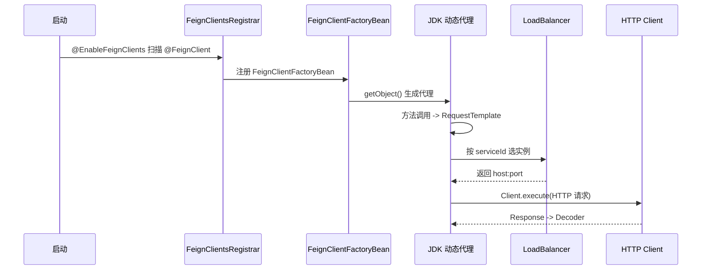

# Spring Cloud OpenFeign · 声明式服务调用

> 一句话定位：面试问 OpenFeign，核心是「一个接口方法怎么变成一次 HTTP 调用」，以及 `@FeignClient` 的字段、Encoder/Decoder、LoadBalancer 各在哪一层。
> 版本前提：Spring Cloud OpenFeign **5.0.x**（2025.1 Oakwood 列车，配 Spring Boot 4.x）；Ribbon 从 **Spring Cloud 2020.0** 起已移除。

## 1. 是什么

OpenFeign 是 Spring Cloud 对 Netflix Feign 的增强版，把 HTTP 调用写成 Java 接口：声明一个 `@FeignClient` 接口，调用它的方法就等于发一次 HTTP 请求。它负责「注解解析、请求模板构建、参数编码、响应解码、负载均衡寻址、拦截器」，但不负责熔断本身。

## 2. 为什么这样设计

用 `RestTemplate` 调服务，每个调用点都要拼 URL、设 header、处理序列化，重复且容易写错。OpenFeign 用**动态代理**把这些模板化：接口方法签名就是契约，注解描述路径和参数，运行时自动生成实现。

和 Dubbo 的区别在协议层：Dubbo 是二进制 RPC，强接口契约、性能高，适合内部服务；OpenFeign 是 HTTP/REST，通用、易调试、跨语言，适合对外和异构系统。

## 3. 底层怎么实现

### 3.1 从注解到代理



1. `@EnableFeignClients` 通过 `@Import(FeignClientsRegistrar.class)` 扫描所有 `@FeignClient` 接口。
2. 每个接口注册一个 `FeignClientFactoryBean`，以及一份 `FeignClientSpecification`（存配置）。
3. `FeignClientFactoryBean.getObject()` 构建 `Feign.Builder`，装配 `Contract`、`Encoder`、`Decoder`、`Client`、`RequestInterceptor`，再调用 `target()`。
4. `ReflectiveFeign.newInstance()` 用 **JDK 动态代理**生成实现，方法映射到 `MethodHandler`（默认 `SynchronousMethodHandler`）。
5. 调用时把参数填进 `RequestTemplate`，经拦截器后交给 `Client.execute()`，响应由 `Decoder` 反序列化。

### 3.2 `@FeignClient` 的属性字段

以 Spring Cloud OpenFeign 5.0.x 的官方 `@FeignClient` 源码为准：

| 属性 | 类型与默认值 | 作用 | 关键点 |
| --- | --- | --- | --- |
| `value` / `name` | `String`，空 | 服务名 | 二者用 `@AliasFor` 互为别名，**`name` 必填**；支持 `${...}` 占位符；决定 LoadBalancer 的 `serviceId` |
| `contextId` | `String`，空 | 客户端上下文 ID | 同一个服务有多个客户端时避免 bean 名冲突；也是配置的 key |
| `url` | `String`，空 | 绝对地址或主机名 | **配了 `url` 就直连，不再走服务发现和负载均衡** |
| `path` | `String`，空 | 统一路径前缀 | 与方法级路径拼接，适合给一组接口加公共前缀 |
| `configuration` | `Class<?>[]`，空 | 自定义配置类 | **不需要 `@Configuration`**；若加了，必须排除组件扫描，否则会变成全局默认 |
| `fallback` | `Class<?>`，`void.class` | 降级类 | 必须实现该接口且是 Spring Bean；需要开启 `feign.circuitbreaker.enabled` |
| `fallbackFactory` | `Class<?>`，`void.class` | 降级工厂 | 能拿到异常，适合统一处理不同失败原因 |
| `primary` | `boolean`，`true` | 是否标 `@Primary` | 多个同类型 Bean 注入冲突时用 |
| `qualifiers` | `String[]`，空 | 限定符 | 配合 `@Qualifier` 使用 |
| `dismiss404` | `boolean`，`false` | 404 是否当正常响应解码 | **5.x 是 `dismiss404`，不是老文章的 `decode404`** |

两个容易踩的版本点：**`serviceId` 已废弃，统一用 `name`**；<span style="color:red">5.x 的 404 开关是 `dismiss404`，网上大量 3.x 文章的 `decode404` 已经过时</span>。

### 3.3 Encoder / Decoder 到底做什么

`Encoder` 和 `Decoder` 是 Feign 的编解码扩展点，只负责**请求体和响应体**：

- `Encoder.encode(Object object, Type bodyType, RequestTemplate template)`：把方法参数序列化进请求体。默认 `SpringEncoder`，内部用 `HttpMessageConverters`（JSON 走 Jackson）。
- `Decoder.decode(Response response, Type type)`：把响应体反序列化成返回类型。默认 `ResponseEntityDecoder`，内部包一层 `SpringDecoder`，也支持 `ResponseEntity<T>`、`Optional<T>`。
- `ErrorDecoder`：非 2xx 响应怎么转异常，默认抛 `FeignException`。
- `Contract`：解析注解生成 `MethodMetadata`，默认 `SpringMvcContract`，所以能用 `@GetMapping`、`@PathVariable`。

<span style="color:red">`Encoder` 只处理请求体，`@RequestParam`、`@PathVariable`、`@RequestHeader` 不走 Encoder</span>，它们由 `Contract` 解析后直接拼进 URL 或 header。这是「为什么我换了 Encoder，路径参数还是不对」的常见原因。

Spring Cloud OpenFeign 默认提供的 Bean：

| 类型 | 默认实现 |
| --- | --- |
| `Decoder` | `ResponseEntityDecoder`（包装 `SpringDecoder`） |
| `Encoder` | `SpringEncoder` |
| `Contract` | `SpringMvcContract` |
| `Logger` | `Slf4jLogger` |
| `Client` | 类路径有 LoadBalancer 时用 `FeignBlockingLoadBalancerClient`，否则用 `Client.Default` |

要覆盖某个客户端，写 `@FeignClient(name = "user", configuration = UserFeignConfig.class)`，在配置类里定义 `Encoder`、`Decoder`、`Contract`、`RequestInterceptor`、`Retryer`、`ErrorDecoder`、`Logger.Level` 的 Bean 即可。

### 3.4 负载均衡：Ribbon 退场后由谁做

<span style="color:red">Ribbon 从 Spring Cloud 2020.0 起已移除</span>，现在由 **Spring Cloud LoadBalancer** 接管。OpenFeign 通过 `FeignBlockingLoadBalancerClient` 包装底层 `Client`：

1. 从请求 URL 里取出 `serviceId`（`http://user-service/user/1` 的 host）。
2. 调 `LoadBalancerClient.choose(serviceId)` 选一个 `ServiceInstance`。
3. 用实例的真实 `host:port` 重写 URL。
4. 再委托给底层 `Client` 发请求。

LoadBalancer 内部是「工厂 + 实例列表供应器 + 算法」三层：

```mermaid
flowchart LR
    A[serviceId] --> B[LoadBalancerClientFactory<br/>每个服务一个子上下文]
    B --> C[ServiceInstanceListSupplier]
    C --> D[DiscoveryClientServiceInstanceListSupplier<br/>从 Nacos/Eureka 拉实例]
    D --> E[CachingServiceInstanceListSupplier<br/>本地缓存, 默认 TTL 35s]
    E --> F[HealthCheckServiceInstanceListSupplier<br/>可选, 主动探活]
    F --> G[ReactorLoadBalancer<br/>RoundRobin / Random]
    G --> H[选中的 ServiceInstance]
```



几个关键实现：

- `LoadBalancerClientFactory` 继承 `NamedContextFactory`，**每个 `serviceId` 一个子上下文**，所以不同服务可以配不同的 `ServiceInstanceListSupplier` 和负载均衡算法。
- `BlockingLoadBalancerClient` 是阻塞适配器，内部从工厂拿到 `ReactiveLoadBalancer` 再 `choose`。
- 默认算法是 `RoundRobinLoadBalancer`，用 `AtomicInteger` 自增取模：`int pos = position.incrementAndGet() & Integer.MAX_VALUE; instances.get(pos % instances.size())`。`& Integer.MAX_VALUE` 是防溢出后变负数。
- `RandomLoadBalancer` 随机选；需要加权、响应时间、同机房优先时，用 `WeightedServiceInstanceListSupplier`、`ZonePreferenceServiceInstanceListSupplier` 或自己实现 `ReactorServiceInstanceLoadBalancer`。
- 实例列表默认走 `DiscoveryClientServiceInstanceListSupplier`，外面包 `CachingServiceInstanceListSupplier`，**缓存 TTL 默认 35s**（`spring.cloud.loadbalancer.cache.ttl`），容量 256，有 Caffeine 就用 Caffeine，否则用 `ConcurrentMapCache`。
- 需要主动探活时加 `spring.cloud.loadbalancer.configurations=health-check`，默认每 **15s** 探一次 `/actuator/health`，初始延迟 5s。
- `@LoadBalanced` 的 `RestTemplate` 靠 `LoadBalancerInterceptor` 拦截；WebClient 用 `ReactorLoadBalancerExchangeFilterFunction`；Feign 用 `FeignBlockingLoadBalancerClient`。

自定义某个服务的算法：

```java
@LoadBalancerClient(name = "order-service", configuration = OrderLbConfig.class)
class OrderLbConfig {
    @Bean
    ReactorServiceInstanceLoadBalancer orderLb(
            LoadBalancerClientFactory factory) {
        return new WeightedLoadBalancer(
                factory.getLazyProvider("order-service",
                        ServiceInstanceListSupplier.class),
                "order-service");
    }
}
```

**缓存会带来陈旧窗口**：注册中心感知下线 + 客户端拉取 + 本地缓存 TTL 叠加，最坏情况下可能几分钟仍在往死实例发请求。Eureka 的 30s 心跳、90s 过期、60s 驱逐、30s 拉取，再加 35s 缓存，叠起来就能到分钟级；Nacos 的感知更快，但也不是零延迟。要缩短窗口，调小缓存 TTL、开健康检查、配合重试和熔断。

### 3.5 底层协议与客户端

<span style="color:red">默认 `Client.Default` 用 JDK 的 `HttpURLConnection`，没有连接池</span>。协议是 **HTTP/1.1 + REST/JSON**，不是 Dubbo 的二进制 RPC。要连接池和高性能，换 Apache HttpClient 5（`feign-hc5`）或 OkHttp（`feign-okhttp`），对应开关 `feign.hc5.enabled` / `feign.okhttp.enabled`；换后可支持 HTTP/2。

超时默认 **connectTimeout=10s、readTimeout=60s**（`FeignClientProperties`），对线上接口太长，容易把线程池拖死，必须按接口调短。重试默认关闭（`Retryer.NEVER_RETRY`），要开就用 `Retryer.Default`，且只能对幂等接口开。

### 3.6 熔断与超时

<span style="color:red">Feign 本身不做熔断，熔断由 Spring Cloud CircuitBreaker 承担</span>。打开 `feign.circuitbreaker.enabled=true`，底层接 Resilience4j 或 Sentinel；用 `@FeignClient(fallback = XxxFallback.class)` 或 `fallbackFactory` 指定降级实现。早期 Hystrix 时代是另一套，现在别再答 Hystrix。

## 4. 生产中的问题与排查

- **调用超时**：先看 `connect-timeout`/`read-timeout`，再看下游 RT、连接池、线程池。默认 60s 的读超时会让故障扩散，通常调到秒级。
- **缺 LoadBalancer 依赖**：启动或调用报 `No Feign Client for loadBalancing defined`，加上 `spring-cloud-starter-loadbalancer`；或 `@FeignClient` 写了 `url` 又期望负载均衡。
- **重试导致重复下单**：非幂等接口开了重试。只对查询类接口重试，写接口用幂等键兜底。
- **连接数打满**：默认 `HttpURLConnection` 没有连接池，高并发下频繁建连。换 HttpClient 5/OkHttp 并配置池大小。
- **熔断不生效**：只加了 `fallback` 没开 `feign.circuitbreaker.enabled`，或底层没有 CircuitBreaker 实现。
- **配置类变成全局默认**：`@FeignClient(configuration = X.class)` 的 `X` 如果加了 `@Configuration` 又被组件扫描到，会覆盖所有 Feign 客户端的默认 Bean。把它放到扫描不到的包，或从 `@ComponentScan` 排除。
- **同服务多客户端 bean 冲突**：同一个服务名定义多个 `@FeignClient` 时，用 `contextId` 区分，否则 bean 名和配置 key 会撞。
- **404 处理不符合预期**：5.x 用 `dismiss404` 控制是否把 404 当正常响应解码；不设置时 404 会抛 `FeignException`。

## 5. 可跑实验

- 目录：`labs/spring-distributed-openfeign/`
- 目的：观察 Feign 代理、LoadBalancer、Encoder/Decoder、超时与熔断。
- 步骤：起两个 provider 实例和一个 consumer；consumer 用 `@FeignClient(name="provider")` 调用；停掉一个 provider 观察 LoadBalancer 切换；把 provider 人为延迟，观察超时与 fallback；自定义一个 `Decoder` 观察响应解析。
- 预期：不配 `url` 时按服务名走 LoadBalancer；缺 LoadBalancer 依赖时报错；超时后走 fallback 而不是一直阻塞。
- 结论：Feign 只负责「声明式 HTTP 封装」，寻址交给 LoadBalancer，熔断交给 CircuitBreaker，编解码交给 Encoder/Decoder。

## 6. 面试问法

**Q：OpenFeign 的调用流程？**
60 秒版本：`@EnableFeignClients` 扫描 `@FeignClient` 接口，为每个接口注册 `FeignClientFactoryBean`；`getObject()` 用 JDK 动态代理生成实现，方法调用映射到 `SynchronousMethodHandler`；它把参数填进 `RequestTemplate`，经拦截器后由 `Client.execute()` 发 HTTP，响应由 `Decoder` 反序列化。

**Q：`@FeignClient` 常用属性有哪些？**
60 秒版本：`value`/`name` 是服务名且互为别名，`name` 必填；`url` 配了就走直连、跳过负载均衡；`path` 是统一前缀；`contextId` 区分同服务多客户端；`configuration` 指定自定义配置；`fallback`/`fallbackFactory` 指定降级；`dismiss404` 控制 404 是否解码。`serviceId` 已废弃，`decode404` 在 5.x 已换成 `dismiss404`。

**Q：Encoder 和 Decoder 分别做什么？**
60 秒版本：Encoder 把方法参数序列化进请求体，默认 `SpringEncoder` 用 `HttpMessageConverters`；Decoder 把响应体反序列化成返回类型，默认 `ResponseEntityDecoder` 包装 `SpringDecoder`。`@RequestParam`、`@PathVariable` 不走 Encoder，由 `Contract` 拼进 URL。非 2xx 由 `ErrorDecoder` 处理。

**Q：LoadBalancer 怎么实现负载均衡？**
60 秒版本：`LoadBalancerClientFactory` 为每个 `serviceId` 建子上下文，`ServiceInstanceListSupplier` 从 `DiscoveryClient` 拉实例并套缓存（默认 TTL 35s），默认 `RoundRobinLoadBalancer` 用 `AtomicInteger` 自增取模选实例；`@LoadBalanced` RestTemplate 由 `LoadBalancerInterceptor` 拦截，Feign 由 `FeignBlockingLoadBalancerClient` 包装。

**Q：Ribbon 和 LoadBalancer 什么关系？**
60 秒版本：Ribbon 从 **Spring Cloud 2020.0** 起被移除，替代品是 Spring Cloud LoadBalancer。OpenFeign 通过 `FeignBlockingLoadBalancerClient` 按 `serviceId` 选实例、重写 URL，再委托底层 HTTP Client 发送。

**Q：Feign 的熔断怎么做？**
60 秒版本：Feign 本身不实现熔断，靠 Spring Cloud CircuitBreaker。开 `feign.circuitbreaker.enabled=true`，底层接 Resilience4j 或 Sentinel，用 `fallback`/`fallbackFactory` 指定降级逻辑。Hystrix 已是历史。

## 7. 追问链 · 参考答案

| 层级 | 问题 | 参考答案要点 |
| --- | --- | --- |
| L1 | Feign 和 OpenFeign 什么区别？ | Feign 是 Netflix 的声明式 HTTP 客户端；OpenFeign 是社区接管的后续项目，Spring Cloud OpenFeign 是在其上的 Spring 集成。 |
| L2 | 为什么 Feign 用 JDK 动态代理？ | `@FeignClient` 是接口，没有实现类；JDK 代理在运行时生成实现，把方法调用转成 `RequestTemplate`。 |
| L3 | `@FeignClient` 的 `value` 和 `name` 什么关系？ | 二者用 `@AliasFor` 互为别名，都是服务名；**`name` 必填**，决定 LoadBalancer 的 `serviceId`。 |
| L4 | `url` 和 `name` 同时配会怎样？ | 配了 `url` 就直连，**跳过服务发现和负载均衡**；`name` 仍要写，用于 bean 名和配置。 |
| L5 | `contextId` 解决什么问题？ | 同一个服务定义多个 `@FeignClient` 时，用 `contextId` 区分客户端上下文、bean 名和配置 key，避免冲突。 |
| L6 | Encoder 和 Decoder 的边界在哪？ | Encoder 只处理请求体；Decoder 只处理响应体；路径参数、查询参数、header 由 `Contract` 解析，不进 Encoder。 |
| L7 | LoadBalancer 默认算法是什么？ | `RoundRobinLoadBalancer`，`AtomicInteger` 自增后 `& Integer.MAX_VALUE` 再对实例数取模；`RandomLoadBalancer` 可替换。 |
| L8 | LoadBalancer 的实例列表从哪来？ | `ServiceInstanceListSupplier` 链：`DiscoveryClientServiceInstanceListSupplier` 从注册中心拉，`CachingServiceInstanceListSupplier` 缓存（默认 35s），可选健康检查过滤。 |
| L9 | 默认超时是多少，为什么要改？ | 默认 **connect 10s、read 60s**；对线上接口太长，故障时会长时间占用线程，通常按接口调到秒级，并配熔断。 |

## 8. 误区 · 正解

| 误区 | 正解 |
| --- | --- |
| 「Feign 自带负载均衡和熔断」 | Feign 只做声明式 HTTP 封装；负载均衡交给 **Spring Cloud LoadBalancer**，熔断交给 **Spring Cloud CircuitBreaker**。 |
| 「现在还是 Ribbon 做负载均衡」 | <span style="color:red">Ribbon 从 Spring Cloud 2020.0 起已移除</span>，用 `spring-cloud-starter-loadbalancer`，否则报 `No Feign Client for loadBalancing defined`。 |
| 「Feign 默认用连接池」 | <span style="color:red">默认 `HttpURLConnection` 没有连接池</span>，高并发要换 HttpClient 5 或 OkHttp。 |
| 「`@FeignClient` 的 404 开关叫 `decode404`」 | 5.x 是 **`dismiss404`**；`decode404` 是 3.x 及更早的写法。`serviceId` 也已废弃，改用 `name`。 |
| 「Encoder 能处理路径参数」 | `Encoder` 只处理请求体；`@PathVariable`、`@RequestParam`、`@RequestHeader` 由 `Contract` 解析后拼进 URL/header。 |
| 「Feign 是 RPC，和 Dubbo 一样」 | Feign 是 **HTTP/REST**，文本协议、易调试、跨语言；Dubbo 是二进制 RPC，性能更高但契约更重。 |

## 9. 我的薄弱点

（学完后同步到 `weakness.md`）
