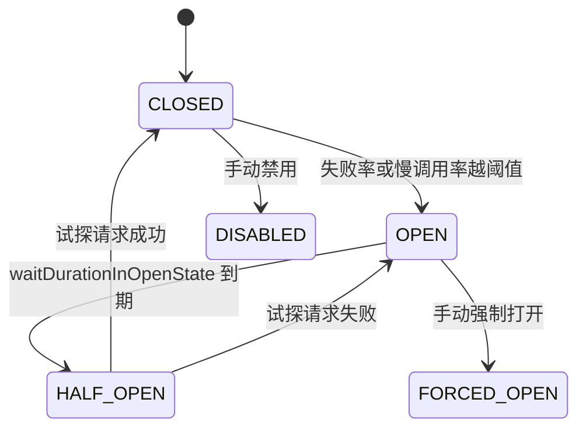

# Resilience4j · 轻量级容错库

> 一句话定位：Resilience4j 面试考的是「装饰器怎么叠、每个组件的状态和参数是什么、失败时到底哪一层先触发」。
> 版本前提：Resilience4j **2.4.0**（2026-03-15 最新稳定）；Spring Boot 4.x 用 `resilience4j-spring-boot4`，Boot 3.x 用 `resilience4j-spring-boot3`。master 上的 3.x 面向 Java 21，尚未正式发布，生产先锁 **2.4.0**。

## 1. 是什么

Resilience4j 是受 Hystrix 启发、完全重写的 Java 容错库。它不做「服务端代理」，而是在**调用点**用装饰器包住业务代码，按需叠加熔断、限流、舱壁、重试、超时。核心模块有五个：`CircuitBreaker`、`Bulkhead`、`RateLimiter`、`Retry`、`TimeLimiter`。`Fallback` 不是独立模块，是一种装饰/降级模式。

## 2. 为什么这样设计

Hystrix 用**线程池隔离**，每个依赖一个线程池，资源开销大、上下文切换贵，且已停止维护。Resilience4j 用**装饰器 + 函数式**：`Supplier`、`Callable`、`CompletionStage` 都能包，按需引入模块，不强绑定 Spring。

它的设计原则是「一个后端一个实例」：每个远程服务配一个独立的 `CircuitBreaker`/`RateLimiter`，不要全局共用一个，否则一个慢依赖会污染所有调用。

Spring Framework 7 把 `@Retryable`、`@ConcurrencyLimit` 收进了核心，但**熔断、限流、带等待的舱壁、降级、监控面板仍然是 Resilience4j 的职责**。不要把两者混为一谈。

## 3. 底层怎么实现

### 3.1 CircuitBreaker（断路器）

状态机是核心：



`CLOSED` 正常放行并统计；`OPEN` 直接拒绝，抛 `CallNotPermittedException`；`HALF_OPEN` 放行 `permittedNumberOfCallsInHalfOpenState` 个试探请求，成功回 `CLOSED`，失败回 `OPEN`。另有 `DISABLED`、`FORCED_OPEN`、`METRICS_ONLY` 三个特殊状态。

统计用**滑动窗口**，两种类型：

| 类型 | 含义 | 关键参数 |
| --- | --- | --- |
| `COUNT_BASED` | 按最近 N 次调用统计 | `slidingWindowSize` 默认 **100** |
| `TIME_BASED` | 按最近 N 秒统计 | `slidingWindowSize` 单位是秒 |

关键默认值（2.4.0）：

| 参数 | 默认值 | 作用 |
| --- | --- | --- |
| `failureRateThreshold` | **50%** | 失败率阈值 |
| `slowCallRateThreshold` | **100%** | 慢调用比例阈值 |
| `slowCallDurationThreshold` | **60s** | 超过它算慢调用 |
| `minimumNumberOfCalls` | **100** | 少于此数不计算比例 |
| `waitDurationInOpenState` | **60s** | OPEN 持续时长 |
| `permittedNumberOfCallsInHalfOpenState` | **10** | 半开放行数 |
| `automaticTransitionFromOpenToHalfOpenEnabled` | **false** | 是否到点自动半开 |

实现上，`CircuitBreakerStateMachine` 用 `AtomicReference<CircuitBreakerState>` 保存当前状态，`CircuitBreakerMetrics` 基于滑动窗口累计成功、失败、慢调用数；每次调用结束回调 `onSuccess`/`onError`/`onSlowCall`，再判断是否越阈值。状态切换是原子的，但**不是分布式熔断**，每个实例各算各的。

### 3.2 Bulkhead（舱壁隔离）

两种实现：

| 类型 | 机制 | 关键参数 | 适用 |
| --- | --- | --- | --- |
| `SemaphoreBulkhead` | 信号量，限制并发数 | `maxConcurrentCalls` 默认 **25**、`maxWaitDuration` 默认 **0** | 同步调用 |
| `ThreadPoolBulkhead` | 独立线程池 | `maxThreadPoolSize` 默认 **4**、`coreThreadPoolSize` 默认 **1**、`queueCapacity` 默认 **100**、`keepAliveDuration` 默认 **20ms** | 异步/阻塞调用 |

并发满了抛 `BulkheadFullException`。信号量版轻量，但没有「等待队列」之外的隔离；线程池版能隔离阻塞，但线程切换有成本。Hystrix 的线程池隔离就是后者，Resilience4j 把选择权交给你。

### 3.3 RateLimiter（限流）

默认实现 `AtomicRateLimiter`，本质是**令牌桶**：

- `limitForPeriod`：一个刷新周期内允许的请求数。
- `limitRefreshPeriod`：刷新周期。
- `timeoutDuration`：拿不到令牌时最多等多久，`0` 表示立即失败。

内部用 `AtomicRateLimiter.State` 保存 `activeCycle`、`activePermissions`、`nanosToWait`，通过 CAS 更新，避免锁竞争；拿不到许可抛 `RequestNotPermitted`。另有 `SemaphoreBasedRateLimiter`，但默认用原子版。

默认值很宽松（`limitForPeriod=50`、`limitRefreshPeriod=500ns`、`timeoutDuration=5s`），生产必须显式配，否则等于没限流。

### 3.4 Retry（重试）

- `maxAttempts`：**包含首次调用**，默认 **3**，也就是最多执行 3 次，不是「重试 3 次」。
- `waitDuration`：默认 **500ms**。
- `retryExceptions` / `ignoreExceptions`：哪些异常重试、哪些直接抛。
- `intervalFunction`：可以配指数退避、随机抖动。
- `retryOnResult`：按返回值决定是否重试。

<span style="color:red">`maxAttempts=3` 是总共 3 次调用，而 Spring Framework 7 的 `@Retryable(maxRetries=3)` 是「首次 + 3 次重试 = 4 次」</span>，从一套配置迁到另一套时最容易差一次。

重试只对**幂等**操作开。写接口重试会重复下单/重复扣款，重试还会放大流量形成重试风暴。

### 3.5 TimeLimiter（超时控制）

<span style="color:red">TimeLimiter 只支持异步调用</span>：`CompletableFuture`、`Mono`、`Flux`。同步方法用不了，因为 Java 没有安全的「中断任意线程」机制。

- `timeoutDuration`：默认 **1s**。
- `cancelRunningFuture`：默认 **true**，超时后取消任务。

内部用 `ScheduledExecutorService` 在超时点把 future 完成为 `TimeoutException`。同步调用的超时要靠 HTTP 客户端、`RestClient`、数据库驱动自己的 timeout，不要指望 TimeLimiter。

### 3.6 Fallback（降级）

<span style="color:red">Fallback 不是 Resilience4j 的独立模块</span>，没有 `FallbackRegistry`。它是两种用法：

- 注解式：`@CircuitBreaker(name = "payment", fallbackMethod = "payFallback")`，降级方法签名必须与原方法一致，最后一个参数可以是 `Throwable` 或具体异常。
- 函数式：`Decorators.ofSupplier(supplier).withFallback(exception -> ...)`，或用 `Try.of(...).recover(...)`。

降级方法要返回**可用的兜底结果**（缓存、空列表、默认值），而不是把异常继续抛给上层。只捕获你真正能处理的异常，不要把参数错误、序列化错误也吞掉。

### 3.7 装饰器顺序与 Spring AOP

函数式写法：

```java
Supplier<String> decorated = Decorators.ofSupplier(supplier)
        .withBulkhead(bulkhead)
        .withCircuitBreaker(circuitBreaker)
        .withRetry(retry)
        .withRateLimiter(rateLimiter)
        .withTimeLimiter(timeLimiter, scheduler)
        .withFallback(List.of(TimeoutException.class,
                CallNotPermittedException.class,
                BulkheadFullException.class), e -> "fallback")
        .decorate();
```

**后 `with` 的在外层**，所以上面的顺序从外到内是 Fallback → TimeLimiter → RateLimiter → Retry → CircuitBreaker → Bulkhead。顺序会改变语义：

- Retry 在 CircuitBreaker 外层：每次重试都要过熔断器，熔断打开时重试会直接拿 `CallNotPermittedException`。
- Retry 在 CircuitBreaker 内层：熔断器把「一次逻辑调用 + 多次重试」当成一个整体统计，失败率会被重试放大。

注解式依赖 Spring AOP，需要 `spring-boot-starter-aop`；注解要打在**外部调用能经过代理**的 public 方法上，同类自调用不生效。多个注解叠加时用 `@Order` 控制切面顺序，别靠猜。

### 3.8 配置示例

```yaml
resilience4j:
  circuitbreaker:
    instances:
      payment:
        failure-rate-threshold: 50
        minimum-number-of-calls: 20
        sliding-window-type: COUNT_BASED
        sliding-window-size: 50
        wait-duration-in-open-state: 10s
        permitted-number-of-calls-in-half-open-state: 5
        slow-call-duration-threshold: 2s
        slow-call-rate-threshold: 60
  bulkhead:
    instances:
      payment:
        max-concurrent-calls: 20
        max-wait-duration: 10ms
  ratelimiter:
    instances:
      payment:
        limit-for-period: 20
        limit-refresh-period: 1s
        timeout-duration: 0
  retry:
    instances:
      payment:
        max-attempts: 3
        wait-duration: 200ms
        enable-exponential-backoff: true
        exponential-backoff-multiplier: 2
  timelimiter:
    instances:
      payment:
        timeout-duration: 2s
        cancel-running-future: true
```

## 4. 生产中的问题与排查

- **模块选错**：Boot 4.x 要用 `resilience4j-spring-boot4`，Boot 3.x 用 `resilience4j-spring-boot3`；引错会出现自动配置不生效或类冲突。
- **注解不生效**：同类自调用、private 方法、没引 `spring-boot-starter-aop`，都会让切面绕过。
- **fallback 签名不对**：参数列表必须和原方法一致，最后可以多一个异常参数；返回类型也要兼容，否则启动或调用时报错。
- **`maxAttempts` 理解错**：它包含首次调用，配 3 就是总共 3 次；和 Spring 的 `@Retryable(maxRetries=3)` 不是一回事。
- **TimeLimiter 用在同步方法上**：不生效，超时还得靠 HTTP 客户端或数据库超时。
- **过度保护**：一个调用叠五六个装饰器，排查时不知道是哪一层拒绝的。先把超时、重试、熔断的边界理清，再按需叠加。
- **熔断器频繁抖动**：`minimumNumberOfCalls` 太小、`failureRateThreshold` 太低，正常波动就打开。核心接口用「慢调用比例 + 较长熔断时长」，非核心用「异常比例 + 较短时长」。
- **监控缺失**：接 `resilience4j-micrometer` 和 Actuator，至少看 `circuitbreakers`、`ratelimiters`、`bulkheads` 的状态和失败率。

## 5. 可跑实验

- 目录：`labs/spring-distributed-resilience4j/`
- 目的：观察熔断状态机、舱壁拒绝、限流、重试和降级。
- 步骤：起 Spring Boot 4.1 + `resilience4j-spring-boot4` 2.4.0；写一个随机延迟/抛错的下游；给调用加 `@CircuitBreaker` + `@Bulkhead` + `@RateLimiter` + `@Retry`；用压测工具打流量，观察日志和 Actuator 状态。
- 预期：失败率越阈值后熔断打开、走 fallback；并发超过舱壁抛 `BulkheadFullException`；限流超过配额抛 `RequestNotPermitted`；重试次数与 `maxAttempts` 一致。
- 结论：每个组件解决一种失败模式，叠在一起时顺序决定谁先触发。

## 6. 面试问法

**Q：Resilience4j 是什么，和 Hystrix 有什么区别？**
60 秒版本：Resilience4j 是轻量级容错库，用装饰器包住调用，按需组合熔断、限流、舱壁、重试、超时。Hystrix 用线程池隔离，资源开销大、已停更；Resilience4j 用信号量/原子状态 + 函数式装饰，模块化、开销小。

**Q：熔断器的状态机和关键参数？**
60 秒版本：`CLOSED → OPEN → HALF_OPEN`。失败率或慢调用率越阈值进 OPEN，直接拒绝；`waitDurationInOpenState` 到期进 HALF_OPEN，放少量试探请求，成功回 CLOSED、失败回 OPEN。关键参数有 `failureRateThreshold`、`minimumNumberOfCalls`、`slidingWindowSize`、`permittedNumberOfCallsInHalfOpenState`。

**Q：Bulkhead 的信号量和线程池怎么选？**
60 秒版本：信号量版限制并发数，轻量，适合同步调用；线程池版给每个依赖独立线程池，能隔离阻塞，但有线程切换成本。同步、短调用优先信号量；会阻塞、需要强隔离用线程池。

**Q：RateLimiter 的令牌桶怎么实现？**
60 秒版本：`AtomicRateLimiter` 用 `limitForPeriod`、`limitRefreshPeriod`、`timeoutDuration` 三个参数，内部用 `State` 记录当前周期和剩余许可，CAS 更新，拿不到许可抛 `RequestNotPermitted`。

**Q：Retry 的 `maxAttempts` 是重试次数吗？**
60 秒版本：不是，**包含首次调用**。`maxAttempts=3` 是总共 3 次调用，即重试 2 次；Spring Framework 7 的 `@Retryable(maxRetries=3)` 是首次 + 3 次重试 = 4 次。迁移时注意差一次。

**Q：TimeLimiter 能用在同步方法上吗？**
60 秒版本：不能。TimeLimiter 只支持 `CompletableFuture`、`Mono`、`Flux` 这类异步返回，靠 `ScheduledExecutorService` 在超时点完成异常。同步超时要用 HTTP 客户端、`RestClient` 或数据库驱动的 timeout。

**Q：Fallback 是 Resilience4j 的模块吗？**
60 秒版本：不是。它没有独立的 Registry，是注解里的 `fallbackMethod` 或 `Decorators.withFallback` 提供的装饰模式；降级方法要和原方法签名兼容，返回可用的兜底结果。

## 7. 追问链 · 参考答案

| 层级 | 问题 | 参考答案要点 |
| --- | --- | --- |
| L1 | Resilience4j 有哪些核心模块？ | `CircuitBreaker`、`Bulkhead`、`RateLimiter`、`Retry`、`TimeLimiter`；`Fallback` 是模式不是模块，另有 `Cache`。 |
| L2 | 熔断器的滑动窗口怎么统计？ | `COUNT_BASED` 按最近 N 次调用，`TIME_BASED` 按最近 N 秒；`CircuitBreakerMetrics` 累计成功/失败/慢调用，越阈值切换状态。 |
| L3 | OPEN 状态为什么不是永久拒绝？ | `waitDurationInOpenState` 到期进 `HALF_OPEN` 放试探流量，成功回 `CLOSED`、失败回 `OPEN`，避免永久熔断或刚恢复就被打回。 |
| L4 | 信号量舱壁和线程池舱壁的区别？ | 信号量只限并发数，轻量；线程池有独立队列和线程，能隔离阻塞，但切换成本高。 |
| L5 | 重试和熔断叠加时谁在外层？ | 取决于 `with`/`@Order` 的顺序；Retry 在外层时每次重试都过熔断，在内层时熔断把重试当一个整体统计。 |
| L6 | 为什么 TimeLimiter 只支持异步？ | Java 没有安全的强制中断线程机制，只能对 `CompletableFuture`/Reactive 做超时完成，同步调用要靠 I/O 客户端自己的 timeout。 |
| L7 | 一个后端为什么要一个独立实例？ | 不同依赖的失败模式不同，共用熔断器会让一个慢依赖污染所有调用；Resilience4j 的原则是一个后端一个实例。 |
| L8 | 注解不生效通常是什么原因？ | 同类自调用、private 方法、缺 `spring-boot-starter-aop`，或注解打在了不经过代理的方法上。 |

## 8. 误区 · 正解

| 误区 | 正解 |
| --- | --- |
| 「`maxAttempts=3` 是重试 3 次」 | <span style="color:red">`maxAttempts` 包含首次调用</span>，3 就是总共 3 次；Spring 的 `@Retryable(maxRetries=3)` 才是 4 次。 |
| 「TimeLimiter 可以给同步方法加超时」 | <span style="color:red">TimeLimiter 只支持异步返回</span>；同步超时用 HTTP 客户端或数据库 timeout。 |
| 「Fallback 是 Resilience4j 的一个模块」 | <span style="color:red">Fallback 不是独立模块</span>，是 `fallbackMethod`/`Decorators.withFallback` 的装饰模式。 |
| 「熔断打开后请求会一直失败」 | `waitDurationInOpenState` 到期会进 `HALF_OPEN` 试探，成功就恢复；不是永久拒绝。 |
| 「装饰器叠得越多越安全」 | 叠加会改变语义、增加排查难度；先把超时、重试、熔断的边界理清，再按需加舱壁和限流。 |
| 「Boot 4 继续用 `resilience4j-spring-boot3`」 | <span style="color:red">Boot 4.x 用 `resilience4j-spring-boot4`</span>；引错模块会导致自动配置不生效或类冲突。 |

## 9. 我的薄弱点

（学完后同步到 `weakness.md`）
