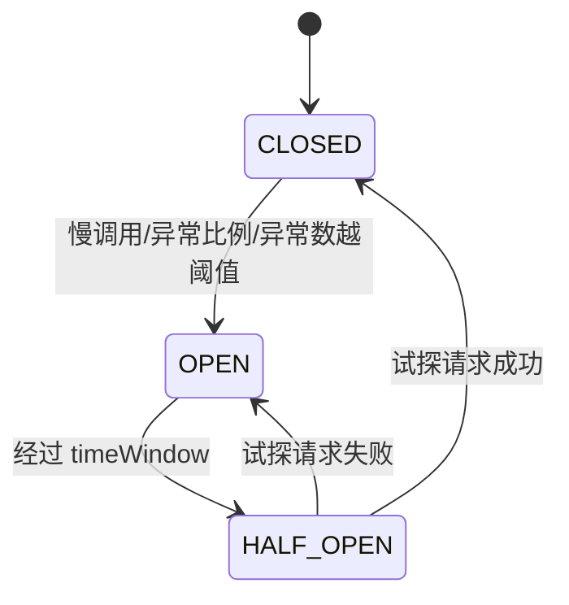

# Spring Cloud Alibaba · Sentinel 流控与熔断降级

> 一句话定位：Sentinel 面试考的是「流控规则怎么统计、熔断状态机怎么转、雪崩到底怎么被止住」，不是背几个名词。
> 版本前提：Sentinel **1.8.10**（2026-05-21 最新稳定）；Spring Cloud Alibaba **2025.1.0.0** 内置 **1.8.9**。JDK 1.8+。

## 1. 是什么

Sentinel 是阿里开源的流量治理组件，围绕「资源」做四件事：**流量控制**（限制 QPS/并发）、**熔断降级**（依赖不稳定时快速失败）、**系统自适应保护**（按 Load/CPU/RT/线程数兜底）、**热点参数限流**（按某个参数值精细限流）。它工作在应用进程内，通过埋点或切面统计每次调用的 QPS、RT、异常数。

## 2. 为什么这样设计

微服务里一个下游变慢，上游线程会被长期占用，连接池、线程池逐渐耗尽，故障沿调用链向上扩散，这就是**雪崩**。传统的做法是加超时和重试，但超时只能让单次调用早死，重试还会放大流量。

Sentinel 的思路是**在调用点做快速失败**：统计窗口内指标一旦越过阈值，直接拒绝后续请求，不再打到下游，给下游留恢复时间。它和 Hystrix 的最大区别是隔离方式：Hystrix 用**线程池隔离**，每个依赖一个线程池，资源开销大、上下文切换贵，已停止维护；Sentinel 用**信号量 + 滑动窗口统计**，轻量得多。Resilience4j 更函数式、更适合 Spring Boot 3/4 生态，但国内项目通常选 Sentinel。

## 3. 底层怎么实现

### 3.1 资源、Entry 与 Slot Chain

所有规则都作用在「资源」上。一次调用通过 `SphU.entry("resource")` 进入，Sentinel 会串起一条 **Slot Chain**：

`NodeSelectorSlot` → `ClusterBuilderSlot` → `LogSlot` → `StatisticSlot` → `AuthoritySlot` → `SystemSlot` → `FlowSlot` → `DegradeSlot`

`StatisticSlot` 负责记录 QPS、RT、异常数；`FlowSlot` 判断流控规则；`DegradeSlot` 判断熔断规则。任何一环抛 `BlockException`，请求就被拦下，走 fallback 或降级逻辑。

### 3.2 滑动窗口统计

默认是 1 秒切成 2 个 500ms 窗口，不是 20 个 50ms。`LeapArray` 维护一个环形数组，按时间推进复用窗口，统计时把当前有效的几个窗口累加。固定窗口在边界会出现「前一秒末 + 后一秒初」的双倍突刺，滑动窗口把统计粒度打细，突刺就被摊平了。窗口数量可以配，但默认 `sampleCount=2`、`intervalInMs=1000`。

### 3.3 流控规则

`FlowRule` 的关键字段：

- `grade`：`QPS` 或 `THREAD`（并发线程数）。
- `strategy`：`DIRECT` 直接、`RELATION` 关联、`CHAIN` 链路。
- `controlBehavior`：快速失败（默认）、Warm Up、匀速排队。
- `count`：阈值。

三种流控效果的区别：

| 效果 | 行为 | 适用 |
| --- | --- | --- |
| 快速失败 | 超过阈值直接拒绝 | 大多数接口 |
| Warm Up | 从 `count/3` 逐步升到 `count`，默认预热 **10s** | 冷启动、JIT 未预热 |
| 匀速排队 | 漏桶，按固定间隔放行，默认最大排队 **500ms** | 削峰填谷、对 RT 有容忍 |

### 3.4 熔断降级与状态机

`DegradeRule` 有三种策略，默认参数以 1.8.x 为准：

| 策略 | `grade` | `count` 含义 | 关键默认值 |
| --- | --- | --- | --- |
| 慢调用比例 | `0` | 慢调用临界 RT（ms） | `slowRatioThreshold=1.0`、`minRequestAmount=5`、`statIntervalMs=1000`、`timeWindow=10s` |
| 异常比例 | `1` | 异常比例阈值（0~1） | 同上 |
| 异常数 | `2` | 统计窗口内异常数 | 同上 |

注意 1.8 起慢调用比例看的是**慢请求占比**，不是「连续 N 个请求都超时」，比旧版更抗个别毛刺。

`CLOSED` 正常放行并统计；`OPEN` 直接拒绝，持续 `timeWindow` 秒；`HALF_OPEN` 放少量试探请求，成功回 `CLOSED`，失败回 `OPEN`。这套状态机是为了避免「刚恢复就被流量再次打挂」的抖动。

### 3.5 规则持久化

规则默认只存在内存，重启即丢。生产要接 Nacos、ZooKeeper 等动态数据源：push 模式由配置中心推规则到客户端，pull 模式由客户端定时拉。只配 Dashboard 不改代码，重启后规则全没，这是线上最常见的坑。

## 4. 雪崩问题

雪崩是**单点故障沿调用链级联放大**：下游变慢或报错，上游线程/连接被长时间占用，逐渐耗尽，最终整条链路不可用。成因通常不是下游彻底挂掉，而是「慢」：慢调用比直接报错更致命，因为它占用资源却不快速释放。

止住雪崩要靠组合拳，单靠一个组件不够：

- **超时**：必须小于上游超时，避免层层等待。
- **熔断**：下游指标越阈值就快速失败，不再打过去。
- **降级**：熔断后返回兜底数据（缓存、空列表、友好提示），不是把异常抛给用户。
- **隔离**：线程池/信号量按依赖划分，一个依赖耗尽不影响其他。
- **限流**：入口限流 + 服务级限流，防止流量超过自身容量。
- **缓存**：减少对下游的实时依赖。

## 5. 生产中的问题与排查

- **规则重启丢失**：接 Nacos/ZK 数据源，确认 push/pull 模式与 namespace 正确。
- **熔断后页面 500**：只配了规则没配 `fallback`/`blockHandler`，`BlockException` 直接冒到上层。降级方法必须返回可用结果。
- **阈值过低频繁熔断**：异常比例设得太低（如 10%），正常波动就触发。核心接口用「慢调用比例 + 较长熔断时长」，非核心用「异常比例 + 较短时长」。
- **集群限流没生效**：单机规则各算各的，集群要部署 Token Server 或嵌入模式，统一配额。
- **统计不准**：热点参数、系统规则都会增加统计开销；先确认规则是否真的命中资源，再看 Dashboard 的实时监控。

## 6. 面试问法

**Q：Sentinel 的流控是怎么实现的？**
60 秒版本：所有规则作用在资源上，请求进入时走 Slot Chain，`StatisticSlot` 用 `LeapArray` 滑动窗口统计 QPS、RT、异常数，`FlowSlot` 按 `FlowRule` 判断是否超阈值。默认 1s 分 2 个 500ms 窗口，避免固定窗口的临界突刺。超阈值抛 `BlockException`，走 fallback。

**Q：熔断降级的三种策略和状态机？**
60 秒版本：慢调用比例、异常比例、异常数。状态机 `CLOSED → OPEN → HALF_OPEN`：CLOSED 正常统计，指标越阈值进 OPEN 直接拒绝，经过 `timeWindow`（默认 10s）进 HALF_OPEN 放试探流量，成功回 CLOSED、失败回 OPEN。

**Q：雪崩怎么产生的，怎么防？**
60 秒版本：下游变慢导致上游线程/连接被占满，故障沿链路级联放大。防护是超时、熔断、降级、隔离、限流、缓存组合，核心是让失败快速发生并返回兜底结果，而不是让请求一直等。

**Q：Sentinel 和 Hystrix 的区别？**
60 秒版本：Hystrix 用线程池隔离，资源开销大、上下文切换贵，已停止维护；Sentinel 用信号量 + 滑动窗口统计，轻量、规则动态化更灵活。隔离方式和统计模型是两者的分水岭。

## 7. 追问链 · 参考答案

| 层级 | 问题 | 参考答案要点 |
| --- | --- | --- |
| L1 | Sentinel 的核心概念是什么？ | 资源、Entry、规则、Slot Chain；所有流控/熔断都围绕资源埋点，`SphU.entry` 进入后由 Slot 链依次判断。 |
| L2 | 为什么用滑动窗口而不是固定窗口？ | 固定窗口在边界会出现双倍流量突刺；滑动窗口把 1s 切成多个小窗口滚动累加，统计更平滑。默认 **2 × 500ms**。 |
| L3 | 慢调用比例和异常比例怎么选？ | 下游「慢」用慢调用比例，下游「错」用异常比例；异常数适合总量大、比例不高的场景。核心接口优先慢调用 + 较长熔断时长。 |
| L4 | HALF_OPEN 为什么要放试探流量？ | 避免熔断永久打开或刚恢复就被打回；少量试探成功才回 CLOSED，失败继续 OPEN，给下游恢复留缓冲。 |
| L5 | 规则怎么持久化？ | 默认内存，重启丢失；接 Nacos/ZK 动态数据源，push 模式由配置中心推送、pull 模式客户端定时拉取，并保证本地缓存兜底。 |

## 8. 误区 · 正解

| 误区 | 正解 |
| --- | --- |
| 「Sentinel 默认 20 个 50ms 窗口」 | 默认是 1s 分 2 个 500ms 窗口，`sampleCount=2`；窗口数可配，但 20×50ms 不是默认值。 |
| 「配了熔断规则就万事大吉」 | 熔断只负责「切断」，还要配 `fallback`/`blockHandler` 返回兜底结果，否则 `BlockException` 会直接打到上层。 |
| 「规则配在 Dashboard 就生效了」 | Dashboard 改的是内存规则，**重启即丢**；生产必须接 Nacos/ZK 做持久化。 |
| 「熔断打开等于服务恢复了」 | OPEN 只是停止打下游，并不代表下游好了；要等 `timeWindow` 后 HALF_OPEN 试探成功才算恢复。 |

## 9. 我的薄弱点

（学完后同步到 `weakness.md`）
