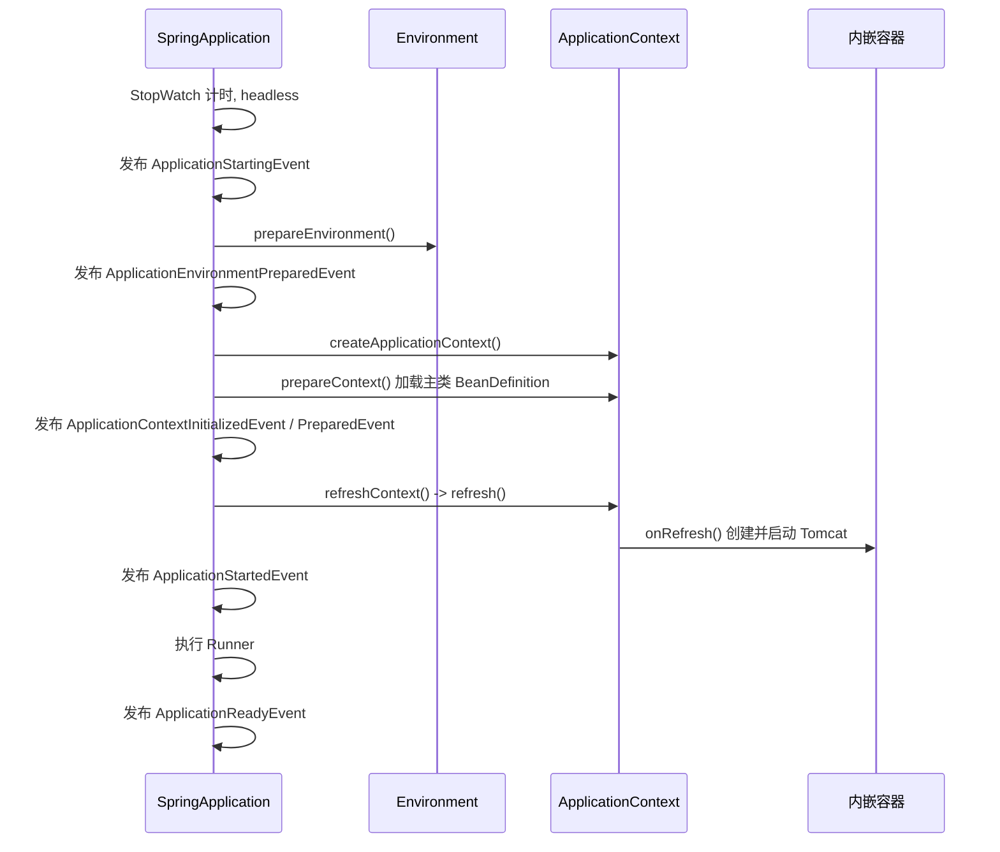

# Spring Boot · 启动流程

> 一句话定位：面试问启动流程，要的是「主干节点 + 事件顺序 + 内嵌容器何时起」，不是逐行背 `SpringApplication.run`。
> 版本前提：Spring Boot **4.1.x**（2026-06 起的 OSS 主线，JDK 17+）；3.5.x 已于 2026-06-30 结束 OSS 支持。3.x/4.x 的启动主干一致，自动配置加载方式仍是 `.imports`。

## 1. 是什么

Spring Boot 的启动入口是 `SpringApplication.run(主类, args)`。它做三件事：准备 `Environment`、创建并刷新 `ApplicationContext`、在刷新过程中启动内嵌 Web 容器。启动过程通过一系列 `ApplicationEvent` 把「走到哪一步」暴露给扩展点。

## 2. 为什么这样设计

传统 Spring 要手写 `ClassPathXmlApplicationContext` 或 `AnnotationConfigApplicationContext`，自己装配环境、加载配置、启动容器。Spring Boot 把这条链路收敛成一次 `run`，并用「约定 + 自动配置」减少样板代码。

事件机制是为了让框架和业务都能在固定时机介入：比如 `EnvironmentPrepared` 时改配置、`ContextInitialized` 时注册 Bean、`Ready` 时做预热。内嵌容器则让应用打成 jar 就能跑，不依赖外部 Tomcat。

## 3. 底层怎么实现

### 3.1 构造 SpringApplication

`new SpringApplication(主类)` 做三件事：

- **推断应用类型**：类路径有 `DispatcherHandler` 且没有 `DispatcherServlet` → `REACTIVE`；有 `Servlet`/`ConfigurableWebApplicationContext` → `SERVLET`；否则 `NONE`。
- **加载扩展**：从 `spring.factories` 读取 `ApplicationContextInitializer` 和 `ApplicationListener`。注意：自动配置类在 Boot 3.x 起只认 `.imports`（`META-INF/spring/org.springframework.boot.autoconfigure.AutoConfiguration.imports`），但 Initializer/Listener 仍走 `spring.factories`，两者不要混。
- **推断主类**：从调用栈里找 `main` 方法所在类。

### 3.2 run 的主干

按顺序拆开：

1. `StopWatch` 开始计时，设置 `java.awt.headless=true`。
2. `getRunListeners` 拿到 `SpringApplicationRunListeners`，发布 **`ApplicationStartingEvent`**。
3. `prepareEnvironment`：创建 `Environment`、加载 `application.yml`/环境变量/命令行参数，发布 **`ApplicationEnvironmentPreparedEvent`**，再把配置绑定到 `SpringApplication`。
4. `printBanner` 打印 Banner。
5. `createApplicationContext`：按应用类型反射创建 `AnnotationConfigServletWebServerApplicationContext`（Servlet）、`AnnotationConfigReactiveWebServerApplicationContext`（Reactive）或 `AnnotationConfigApplicationContext`（None）。
6. `prepareContext`：设置 Environment、执行 Initializer、注册主类为 BeanDefinition，发布 **`ApplicationContextInitializedEvent`** 和 **`ApplicationPreparedEvent`**。
7. `refreshContext`：调用 `AbstractApplicationContext.refresh()` 的十二步，发布 **`ContextRefreshedEvent`**。**内嵌 Tomcat 就在这一步的 `onRefresh()` 里创建并启动**。
8. `afterRefresh`、停止计时。
9. 发布 **`ApplicationStartedEvent`**，执行 `ApplicationRunner` / `CommandLineRunner`。
10. 发布 **`ApplicationReadyEvent`**，应用就绪。异常时走 `handleRunFailure`，发布 **`ApplicationFailedEvent`**。

事件顺序记成一条线：Starting → EnvironmentPrepared → ContextInitialized → Prepared → ContextRefreshed → Started → Ready。

### 3.3 refresh 的十二步与内嵌容器

`refresh()` 是 Spring 的核心，Boot 只是在其上扩展：

| 步骤 | 方法 | 关键动作 |
| --- | --- | --- |
| 1 | `prepareRefresh` | 记录启动时间、初始化 PropertySource |
| 2 | `obtainFreshBeanFactory` | 创建 `DefaultListableBeanFactory` |
| 3 | `prepareBeanFactory` | 注册 `ApplicationContextAwareProcessor` 等 |
| 4 | `postProcessBeanFactory` | 子类扩展，注册 Web scope |
| 5 | `invokeBeanFactoryPostProcessors` | 执行 `ConfigurationClassPostProcessor`，解析 `@ComponentScan`/`@Bean`/`@Import` |
| 6 | `registerBeanPostProcessors` | 注册 BPP |
| 7 | `initMessageSource` | 国际化 |
| 8 | `initApplicationEventMulticaster` | 事件广播器 |
| 9 | `onRefresh` | **Servlet 环境在这里创建并启动 Tomcat** |
| 10 | `registerListeners` | 注册监听器 |
| 11 | `finishBeanFactoryInitialization` | 实例化所有非懒加载单例 |
| 12 | `finishRefresh` | 发布 `ContextRefreshedEvent`、启动 Lifecycle |

内嵌 Tomcat 在第 9 步就启动了，此时第 11 步的业务单例还没全部创建完。所以容器能先接连接，但业务 Bean 是随后才就绪的；启动期如果收到请求，可能碰到 Bean 还没初始化完的情况。

`ServletWebServerApplicationContext.onRefresh()` → `createWebServer()` → `getWebServerFactory()` → `TomcatServletWebServerFactory.getWebServer()`，`DispatcherServlet` 通过 `ServletContextInitializer` 注册进容器。

## 4. 生产中的问题与排查

- **启动慢**：组件扫描范围过大、Bean 太多、自动配置连锁加载。先看启动日志的耗时分布，再考虑缩小 `scanBasePackages`、按需排除自动配置、必要时 `spring.main.lazy-initialization=true`（有首次请求变慢的代价）。
- **循环依赖启动失败**：Spring Boot 2.6+ 默认禁止循环依赖（`spring.main.allow-circular-references=false`），报 `BeanCurrentlyInCreationException`。优先重构解环，不要第一时间加 `@Lazy`。
- **端口占用**：`Web server failed to start. Port 8080 was already in use`，先查占用进程，再改 `server.port`。
- **配置不生效**：确认加载顺序：命令行参数 > 系统属性 > 环境变量 > 外部 `application-{profile}.yml` > 内部 `application.yml`。profile-specific 优先于 profile-agnostic。
- **优雅停机**：`server.shutdown=graceful` + `spring.lifecycle.timeout-per-shutdown-phase=30s`；K8s 还要配合 `preStop` 和就绪探针摘流，否则流量仍会打到正在停机的实例。

## 5. 可跑实验

- 目录：`labs/spring-distributed-boot-startup/`
- 目的：观察事件顺序与内嵌容器启动时机。
- 步骤：注册一个 `ApplicationListener<ApplicationEvent>`，打印事件类型；在某个 `@Bean` 的构造器里打印线程与时间；启动应用对照日志。
- 预期：事件顺序与上文一致；Tomcat 启动日志出现在 `ContextRefreshedEvent` 之前、业务 Bean 初始化之前。
- 结论：启动流程是「环境 → 上下文 → 刷新（含容器）→ Runner → Ready」的线性编排。

## 6. 面试问法

**Q：Spring Boot 启动流程讲一下？**
60 秒版本：`SpringApplication.run` 先推断应用类型、加载 Initializer/Listener，发布 Starting；然后准备 Environment、发布 EnvironmentPrepared；创建 ApplicationContext、加载主类 BeanDefinition、发布 ContextInitialized/Prepared；调用 refresh 十二步，内嵌 Tomcat 在 `onRefresh` 启动；之后发布 Started、执行 Runner、发布 Ready。异常走 Failed。

**Q：内嵌 Tomcat 是什么时候启动的？**
60 秒版本：在 `refresh()` 的第 9 步 `onRefresh()`，由 `ServletWebServerApplicationContext.createWebServer()` 创建并启动，`DispatcherServlet` 通过 `ServletContextInitializer` 注册。此时第 11 步的业务单例还没全部实例化。

**Q：Spring Boot 自动配置是什么时候生效的？**
60 秒版本：在 refresh 第 5 步 `invokeBeanFactoryPostProcessors`，`ConfigurationClassPostProcessor` 解析 `@Import(AutoConfigurationImportSelector)`，从 `.imports` 文件加载候选自动配置类，再按 `@ConditionalOn*` 过滤后注册 BeanDefinition。

**Q：启动慢怎么排查？**
60 秒版本：先看启动日志的耗时分布，定位是扫描、自动配置还是某个 Bean 初始化慢；再缩小扫描范围、排除无用自动配置、延迟初始化；最后用 Actuator 的 `startup` 端点看各阶段耗时。

## 7. 追问链 · 参考答案

| 层级 | 问题 | 参考答案要点 |
| --- | --- | --- |
| L1 | 启动有哪些核心事件？ | Starting → EnvironmentPrepared → ContextInitialized → Prepared → ContextRefreshed → Started → Ready；失败发 Failed。 |
| L2 | Environment 是在哪一步准备的？ | `prepareEnvironment`，在上下文创建之前；它加载配置文件、环境变量、命令行参数，并发布 `ApplicationEnvironmentPreparedEvent`。 |
| L3 | BeanDefinition 是什么时候加载的？ | `prepareContext` 里把主类注册为 BeanDefinition；自动配置的 BeanDefinition 在 refresh 第 5 步由 `ConfigurationClassPostProcessor` 解析后注册。 |
| L4 | 内嵌容器和业务 Bean 的启动顺序？ | 容器在 refresh 第 9 步 `onRefresh` 启动，业务单例在第 11 步才实例化；所以容器先起、业务后就绪。 |
| L5 | 循环依赖为什么 2.6 之后启动失败？ | Spring Boot 2.6+ 默认 `allow-circular-references=false`；字段注入的循环依赖本可被三级缓存解决，但默认策略改成直接报错，逼你重构。 |

## 8. 误区 · 正解

| 误区 | 正解 |
| --- | --- |
| 「Spring Boot 启动就是 new 一个 ApplicationContext」 | 远不止。要准备 Environment、加载 Initializer/Listener、创建上下文、执行 refresh 十二步、启动内嵌容器、跑 Runner，每一步都有事件。 |
| 「内嵌 Tomcat 在 run 的最后才启动」 | Tomcat 在 refresh 第 9 步 onRefresh 就启动了，早于业务单例的实例化。 |
| 「自动配置靠 spring.factories」 | Boot 3.x 起自动配置只认 `AutoConfiguration.imports`；`spring.factories` 仍用于 Initializer/Listener/EnvironmentPostProcessor，两者用途不同。 |
| 「循环依赖加 @Lazy 就行」 | `@Lazy` 只是延迟注入、掩盖设计问题；Boot 2.6+ 默认已禁止循环依赖，优先重构解环。 |

## 9. 我的薄弱点

（学完后同步到 `weakness.md`）
