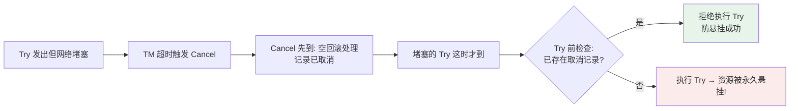

# 分布式事务：强一致 XA/2PC、最终一致 TCC/Saga/可靠消息与 TCC 三大防御

> 2026-10-14 成稿，Spring 与分布式架构主题首讲。
> 答题主线：**先 CAP 定调 → 强一致讲 2PC 及其缺陷 → 最终一致三方案对比 → 落到你问的核心：TCC 的幂等、防空回滚、防悬挂（一套事务控制表全解决）**。最后一节是区分度所在，能讲出代码级细节就是 L3+。

## 一、为什么需要分布式事务

单体数据库的 ACID 靠**单机事务 + 单个 redo log** 保证；一旦拆库拆服务（订单库 / 库存库 / 账户库），一个业务动作横跨多个库，**本地事务管不到了**：

```
订单服务(订单库) ──调用──► 库存服务(库存库) ──调用──► 账户服务(账户库)
   │                        │                        │
   └─ 各自 COMMIT，中间任何一步失败，前面的已提交，后面的没执行 → 数据不一致
```

先抛理论定调（一句话即可，别展开太多）：

- **CAP**：分区容错 P 必选，只能在 C 和 A 里取舍
- **BASE**：基本可用 + 软状态 + **最终一致**——放弃强一致换可用性，是互联网业务的主流选择
- 选型口径：**资金/账务核心链路宁可阻塞也要一致（偏 C）；一般业务宁可先成功后补偿（偏 A，最终一致）**

## 二、强一致性：XA 协议与两阶段提交 2PC

### 1. XA 是协议，2PC 是实现

- **XA**：X/Open 定义的分布式事务协议规范，定义了 TM（事务管理器/协调者）与 RM（资源管理器/数据库）之间的接口（`xa_prepare` / `xa_commit` / `xa_rollback`）
- **2PC（两阶段提交）**：XA 的经典实现。MySQL InnoDB 原生支持 XA（`XA BEGIN/END/PREPARE/COMMIT`）
- Java 侧对应 **JTA**（`UserTransaction`），实现有 Atomikos、Narayana；Seata 的 XA 模式同思路

### 2. 2PC 流程（必画）

```
                 ┌─ 阶段一：准备 Prepare（投票） ─────────────┐
协调者 TM ──prepare──► 参与者 RM1：执行 SQL，写 redo/undo，不提交，锁定资源
协调者 TM ──prepare──► 参与者 RM2：同上
RM1 ──Yes──► TM   RM2 ──Yes──► TM
                 └──────────────────────────────────────────┘
                 ┌─ 阶段二：提交/回滚 Commit ─────────────────┐
全部 Yes：TM ──commit──► RM1、RM2（各库真正提交，释放锁）
任一 No / 超时：TM ──rollback──► RM1、RM2
                 └──────────────────────────────────────────┘
```

### 3. 2PC 的四个缺陷（逐个说清，面试主战场）

| 缺陷 | 说明 |
| --- | --- |
| **同步阻塞** | Prepare 后到 Commit 前，所有参与者**锁着资源等待**，并发吞吐大幅下降——这是性能差的根源 |
| **协调者单点** | TM 在阶段二前崩溃，参与者全部卡死在锁定状态 |
| **数据不一致（脑裂窗口）** | 阶段二 commit 指令只到达部分参与者时 TM 崩溃 → 一部分提交一部分未提交，且无法自动恢复 |
| **性能 + 无法兜底补偿** | 网络多轮 RTT + 锁持有时间长；参与者失败只能回滚，不能业务补偿 |

### 4. 3PC 一句话带过

3PC（CanCommit / PreCommit / DoCommit）引入超时和预提交降低阻塞与单点影响，**但仍无法根治不一致**（超时自动提交同样可能脑裂），工程上很少用。**面试说一句「3PC 牺牲一致性换可用性提升，但没根治，生产罕见」即可。**

### 5. 实践口径

> XA/2PC 适合**并发不高、强一致刚需**的场景（传统金融、同构数据库跨库事务）。互联网高并发场景基本不用——锁资源和协调者瓶颈撑不住吞吐，所以大家转向最终一致。

## 三、最终一致性三方案

### 1. TCC（Try-Confirm-Cancel）

**思想**：把一个业务动作拆成三个业务方法，**业务层手动实现「预留-确认-回滚」**：

| 阶段 | 职责 | 例：扣款 100 元 |
| --- | --- | --- |
| **Try** | 资源**预留**（冻结），做业务检查 | 冻结 100（`frozen += 100`），不动余额 |
| **Confirm** | 确认扣减，**必须成功**（幂等，失败重试） | `balance -= 100, frozen -= 100` |
| **Cancel** | 释放预留（**必须成功**，幂等） | `frozen -= 100` |

特点：
- ✅ 不锁数据库资源（锁的是业务语义的「冻结」字段），**性能好于 XA**；一致性和实时性最好，**准强一致**
- ❌ **业务侵入大**：每个参与方要实现三个方法；Confirm/Cancel 必须考虑幂等、空回滚、悬挂（下一节核心）
- 框架：Seata TCC 模式（注解 `@TwoPhaseBusinessAction`）、ByteFX（早期）、 HIMLY（蚂蚁）

### 2. Saga

**思想**：长事务拆成本地事务序列 T1→T2→…→Tn，每个 Ti 配一个补偿 Ci；某步失败则**反向补偿** C(i-1)→…→C1：

```
正向：T1 下单 → T2 扣库存 → T3 扣款 → T4 发券
T3 失败：C2 回补库存 → C1 取消订单   （反向补偿，不回滚已提交的事务）
```

两种实现：
- **编排式（Orchestration）**：中央协调器驱动状态机（Seata Saga 状态机、Temporal）
- **协同式（Choreography）**：靠事件订阅链式触发（无中心，链路一长难追踪）

特点：
- ✅ 无全局锁、性能好、适合**长流程/跨系统/参与方老旧系统**（对方只有接口没有 TCC 能力也能做补偿）
- ❌ **不保证隔离性**：中间状态对外可见，可能脏读；补偿逻辑也是开发负担；某些操作天然难补偿（发短信、打款）→ 设计成「可补偿 / 不可补偿（前置检查做足）」
- 失败处理策略：**向前重试**（可重复执行的业务）vs **向后补偿**（默认）

### 3. 可靠消息最终一致

**思想**：用「本地事务 + 消息」替代全局协调，靠**消息必达 + 消费方幂等**保证最终一致。两种主流实现：

**① 本地消息表（通用，任何 MQ 都行）**：

```
1. 业务方在【同一个本地事务】里：执行业务 + 插入消息表（status=INIT）
2. 后台任务/事务提交后立即扫描消息表 → 投递 MQ → 标记 SENT
3. 投递失败重试（消息表是持久化的，天然可重投）
4. 消费方消费 + 幂等 → 回执/更新状态 → 上游对账兜底
```

**② RocketMQ 事务消息（中间件原生支持）**：

```
1. 发送半消息（half message，对消费者不可见）
2. 执行本地事务
3. 本地事务成功 → commit 半消息（可见）；失败 → rollback
4. Broker 定时【回查】生产者：「这个 xid 的本地事务到底成没成？」→ 生产者查本地事务状态答复
   （对应 mq/rocketmq 讲义的事务消息章节，可互相引用）
```

特点：
- ✅ **侵入最小、吞吐最高**，适合高并发最终一致场景（下单 → 积分/通知/推荐等旁路系统）
- ❌ 延迟一致（秒级）；**只保证单向**：上游成功则下游必达；**消费方必须幂等**（MQ 至少一次投递）

### 4. 四方案选型总表（必背）

| 方案 | 一致性 | 性能 | 侵入性 | 适用 |
| --- | --- | --- | --- | --- |
| XA/2PC | 强一致 | 差（锁+阻塞） | 低（数据库层） | 低并发强一致、同构库 |
| TCC | 准强一致 | 好 | **高（每方 3 方法）** | 资金核心链路（扣款/冻结） |
| Saga | 最终一致 | 好 | 中（写补偿） | 长流程、跨系统、老系统 |
| 可靠消息 | 最终一致 | **最好** | 低（业务表+消息） | 高并发旁路系统（通知/积分/同步） |

面试选型话术：

> 资金扣减类核心链路用 TCC（一致性和实时性最好，代价是侵入）；上下游解耦的通知/积分类用事务消息；跨多系统长流程（如出行订酒店+机票）用 Saga。**真正的高并发系统通常是组合使用**，而不是单选。

## 四、核心：TCC 的幂等、防空回滚、防悬挂（本地服务的完整实现）

> 这是 TCC 落地时最容易被问穿的工程细节。三者成因不同，但**用同一张「事务控制表」全部解决**。

### 1. 三个问题分别是怎么发生的（先讲成因，再谈解法）

背景：TCC 框架（TM）会在 Try 超时或整体回滚时触发 Cancel，在整体提交时触发 Confirm，且 **Confirm/Cancel 都可能重试**。

**① 空回滚（Empty Rollback）**
- **成因**：Try 因网络/拥堵**没有到达**参与方（或还没执行），但 TM 已经超时判定失败，触发 Cancel → **Cancel 在 Try 之前执行**，参与方收到一个「回滚从未执行过的预留」的请求
- **危害**：Cancel 里按「冻结记录」去释放会失败或误放别人的资源；更糟的是流程后续还会重试 Cancel
- **正确行为**：发现 Try 没执行过 → 记录「该事务分支已取消」并**直接返回成功**（让 TM 认为回滚完成，停止重试）

**② 幂等（Idempotency）**
- **成因**：Confirm / Cancel **都可能被重试多次**（TM 超时重发、网络重发）。TCC 的铁律是 **Confirm/Cancel 必须成功**——失败就无限重试直到成功
- **危害**：Confirm 执行两次 → 扣两次钱；Cancel 执行两次 → 冻结被释放两次（余额账目错乱）
- **正确行为**：同一分支事务的 Confirm/Cancel 无论执行多少次，效果与执行一次相同

**③ 悬挂（Suspension）**
- **成因**：**Try 的网络包在路上堵了很久**：TM 超时先触发了 Cancel（Cancel 执行完：空回滚处理，记了取消标记），**之后堵塞的 Try 才到达**并执行了资源冻结 → 这笔冻结**永远不会有 Confirm/Cancel 再来了**（事务已经结束）→ 资源被「悬挂」占用
- **危害**：比空回滚更隐蔽：客户的钱被永久冻结，账实不符
- **正确行为**：Try 执行前检查该分支是否已有「取消」记录 → 有则**拒绝执行 Try**



### 2. 一张表解决三个问题：事务控制表（分支事务状态表）

```sql
CREATE TABLE tcc_transaction_control (
    xid           VARCHAR(64)  NOT NULL COMMENT '全局事务ID',
    branch_id     VARCHAR(64)  NOT NULL COMMENT '分支事务ID',
    state         TINYINT      NOT NULL COMMENT '1=INIT(Try成功) 2=CONFIRMED 3=CANCELLED',
    create_time   DATETIME     NOT NULL,
    update_time   DATETIME     NOT NULL,
    PRIMARY KEY (xid, branch_id)
) COMMENT 'TCC 事务控制表: 幂等/防悬挂/防空回滚的唯一依据';
```

**三个方法的标准写法（Java 语义，可直接照抄成面试答案）**：

```java
// ============ Try：插入控制记录 + 预留资源 ============
@Transactional
public void tryDeduct(String xid, String branchId, String userId, BigDecimal amount) {
    // 1. 防悬挂：先查是否已有本分支记录（Cancel 抢先写过 CANCELLED 的话，这里能查到）
    TxControl tx = txDao.find(xid, branchId);
    if (tx != null) {
        // Cancel 已执行（空回滚记录）→ 本次 Try 是迟到的堵包，拒绝执行，直接返回
        return;                       // ← 防悬挂
    }
    // 2. 插入 INIT 记录（唯一键 (xid, branch_id) 兜底并发：同分支 Try 重复到达时插入冲突 → 也算幂等）
    try {
        txDao.insert(xid, branchId, State.INIT);
    } catch (DuplicateKeyException e) {
        return;                       // ← Try 幂等（重复 Try 不再执行）
    }
    // 3. 业务预留：冻结金额
    accountDao.freeze(userId, amount);
}

// ============ Confirm：条件更新 INIT→CONFIRMED + 真实扣减 ============
@Transactional
public void confirmDeduct(String xid, String branchId, String userId, BigDecimal amount) {
    // 条件更新：只有 INIT 才允许确认；影响行数=0 说明已 Confirm 过（或已 Cancel）→ 幂等返回成功
    int updated = txDao.updateState(xid, branchId, State.INIT, State.CONFIRMED);
    //  UPDATE tcc_transaction_control SET state=2 WHERE xid=? AND branch_id=? AND state=1
    if (updated == 0) {
        return;                       // ← Confirm 幂等：重复 Confirm 直接成功
    }
    accountDao.deductFrozen(userId, amount);   // balance-=amount, frozen-=amount
}

// ============ Cancel：处理空回滚 + 条件更新 INIT→CANCELLED + 释放 ============
@Transactional
public void cancelDeduct(String xid, String branchId, String userId, BigDecimal amount) {
    // 1. 先查记录
    TxControl tx = txDao.find(xid, branchId);
    if (tx == null) {
        // 空回滚：Try 从未执行过（或未执行完）→ 插入 CANCELLED 记录后直接返回成功
        //   作用一：让 TM 认为回滚成功，不再重试 Cancel          ← 防空回滚
        //   作用二：给迟到的 Try 留下「已取消」的标记，Try 查到后拒绝执行 ← 防悬挂
        try {
            txDao.insert(xid, branchId, State.CANCELLED);
        } catch (DuplicateKeyException e) {
            // 并发 Cancel：另一个已抢先插入并处理，直接成功       ← Cancel 并发幂等
        }
        return;
    }
    // 2. 正常回滚：条件更新 INIT→CANCELLED
    int updated = txDao.updateState(xid, branchId, State.INIT, State.CANCELLED);
    if (updated == 0) {
        return;                       // 已是 CANCELLED（重复 Cancel）或 CONFIRMED → 幂等返回
    }
    accountDao.unfreeze(userId, amount);      // frozen-=amount
}
```

**记忆要点：三招对应三个问题**

| 问题 | 解法（一句话） |
| --- | --- |
| **防悬挂** | **Try 前查记录**：发现 CANCELLED 已存在 → 拒绝执行（Try 永远不能晚于 Cancel 生效） |
| **防空回滚** | **Cancel 发现没记录** → 插入 CANCELLED 标记 + 返回成功（既让 TM 停止重试，又给迟到的 Try 留屏障） |
| **幂等** | **状态机 + 条件更新**：INIT→CONFIRMED / INIT→CANCELLED 的 `UPDATE ... WHERE state=1`，影响行数=0 即「已处理过」直接成功；Try 靠唯一键防重 |

### 3. 关键工程细节（能说出这些就是 L4）

1. **控制表操作与业务操作必须在同一个本地事务里**——保证「记录状态」和「资源变更」原子，否则记录说 CANCELLED 但钱没退，比不防还糟
2. **条件更新用单条 UPDATE 的原子性**，不要「先查再改」两步（查改之间有并发窗口）；唯一键 + `DuplicateKeyException` 是并发插入的最终防线
3. **控制表要清理**：终态（CONFIRMED/CANCELLED）记录定期归档删除（如保留 7 天），否则表无限膨胀
4. **Cancel 插入 CANCELLED 记录本身失败怎么办**：返回失败让 TM 重试 Cancel（此时表里可能有并发记录，按 DuplicateKey 处理）
5. **Seata 的现成方案**：Seata TCC 模式内置 `tcc_fence_log` 防悬挂表 + `useTCCFence=true` 开关，原理与上述完全一致（默认反而关闭，很多项目裸奔——说出这一点就是实战分）；其 `ConnectionProxy` 会把 fence 操作纳入同一本地事务
6. **通用幂等别的做法为什么不够**：唯一索引防「重复提交」但表达不了状态机（Cancel 需要区分「没执行过」和「执行过」）；Token/Redis 幂等在 TM 崩溃重启场景下丢失风险高于数据库表——**用数据库状态表是唯一同时满足持久化 + 并发安全 + 三问题通用的方案**

### 4. 消息方案下的幂等（顺带对比，常被追问）

可靠消息方案的消费方幂等同样是状态表思路：`消费记录表(msg_id 唯一键)`，插入冲突即已处理；或业务表带 `biz_no` 唯一约束直接吸收幂等。**「生产端保证必达（本地消息表/事务消息），消费端保证幂等（唯一键/状态表）」是对偶的两半**，只做一半照样不一致。

## 追问链 · 参考答案

| 层级 | 问题 | 参考答案要点 |
| --- | --- | --- |
| L1 | CAP 和 BASE 怎么理解？四种分布式事务方案各自适合什么场景？ | CAP：分区容错 P 必选，只能在 C 与 A 之间取舍；BASE 是基本可用 + 软状态 + 最终一致。选型：XA/2PC 用于低并发、强一致刚需的同构库；TCC 用于资金核心链路（准强一致、侵入最高）；Saga 用于长流程跨系统；可靠消息用于高并发旁路（通知/积分）。生产通常是组合而非单选。 |
| L2 | 2PC 的四个缺陷逐个说清；TCC 三个阶段各自负责什么？ | 2PC 四缺陷：Prepare 后锁资源同步阻塞、协调者单点、阶段二 commit 部分送达造成脑裂不一致、多轮 RTT 性能差且无法业务补偿。TCC 三阶段：Try 做业务检查与资源预留（`frozen += 100`，不动余额），Confirm 真实扣减（`balance -= 100, frozen -= 100`），Cancel 释放预留；Confirm/Cancel 必须幂等且必须成功。 |
| L3 | 空回滚和悬挂分别是怎么发生的？为什么 Cancel 要「插入记录再返回成功」？ | 空回滚是 Try 未到达（网络/拥堵）而 TM 已超时触发 Cancel；悬挂是 Cancel 先执行完后、堵塞的 Try 才到达并冻结资源，这笔冻结再无 Confirm/Cancel 释放。所以 Cancel 发现无记录时要插入 CANCELLED 再返回成功：既让 TM 停止重试，又给迟到的 Try 留屏障，Try 查到即拒绝执行。 |
| L4 | 为什么条件更新要用「单条 UPDATE」而不是「先查后改」？控制表为什么必须和业务在同一个事务里？ | 先查后改在查与改之间有并发窗口，两次重试可能同时判定「未处理」而各扣一次钱。单条 `UPDATE ... WHERE state=INIT` 靠数据库行锁把判定与修改合成一个原子操作，影响行数 = 0 即已处理。控制表与业务必须同事务，否则记录已是 CANCELLED 而钱没退，比不做防护更糟。 |
| L5 | Seata TCC 的 fence 表是什么原理？`useTCCFence` 默认值是什么？ | 与手写控制表同原理：`tcc_fence_log` 里 Try 前查记录防悬挂、Cancel 无记录则插入 CANCELLED 防空回滚、Confirm/Cancel 用状态条件更新做幂等。差别是 Seata 的 `ConnectionProxy` 会把 fence 操作纳入同一个本地事务。`useTCCFence` 默认 **false**，必须显式开启，很多项目因此裸奔。 |
| L6 | TCC 和事务消息怎么组合使用？ | 核心资金扣减走 TCC，保证准强一致与实时性；旁路的通知、积分、推荐走事务消息解耦，保证必达与吞吐。两者用消息衔接：Confirm 里发正向消息、Cancel 里发「冲正消息」通知下游对账，下游消费侧做幂等。口径是核心链路强一致 + 旁路最终一致，而不是全链路单选一种。 |

## 误区 · 正解

| ❌ 误区 | ✅ 正解 |
| --- | --- |
| 「2PC 能保证强一致」 | 2PC 只是「准强一致 + 阻塞」：阶段二 commit 只到达部分参与者时协调者崩溃，就会出现一部分已提交、一部分未提交且无法自动恢复的脑裂窗口，只能靠日志对账或人工介入。加上 Prepare 后锁资源同步阻塞、协调者单点，所以高并发互联网场景基本不用它。 |
| 「TCC 的 Try 里就完成扣款」 | Try 只做业务检查与资源预留（`frozen += 100`，不动余额），真实扣减在 Confirm（`balance -= 100, frozen -= 100`）。若在 Try 里直接扣款，Cancel 就只能反向加回余额，等于把二阶段退化成「先扣后退」，既丧失隔离性（中间态资金对外可见），也让对账口径变复杂。 |
| 「有空回滚处理就够了，悬挂不会发生」 | 两者是同一次时序错乱的两个后果。Cancel 只返回成功而不落 CANCELLED 标记，迟到的 Try 到达时查不到任何记录，照样执行冻结，而这笔冻结再不会有 Confirm / Cancel 来释放——钱被永久悬挂。所以 Cancel 必须「插入标记再返回成功」，Try 必须先查标记再决定是否执行。 |
| 「幂等靠 Redis setnx 就行」 | TM 的重试是持久行为，可能跨越数小时甚至 TM 重启，Redis 的过期、淘汰、故障切换都可能让标记丢失，重试到来即穿透。可靠做法是与业务同库的唯一键 `(xid, branch_id)` + 状态机条件更新，同时满足持久化、并发安全，并且一套方案覆盖幂等、空回滚、悬挂三个问题。 |
| 「Saga 失败了就回滚」 | Saga 没有回滚，只有**反向补偿**：各 Ti 已本地提交，失败时按 C(i−1)…C1 逆向执行业务补偿。补偿本身也可能失败，需要重试 + 人工兜底；且 Saga 不保证隔离性，中间状态对外可见会脏读，所以发短信、打款这类不可补偿动作要前置做足检查或改造成可补偿设计。 |
| 「可靠消息能保证两边都成功」 | 它只保证单向：上游本地事务成功则下游消息必达；上游回滚则半消息 rollback，下游根本不会执行。完整一致性由两半构成——生产端保证必达（本地消息表 / 事务消息），消费端保证幂等（`msg_id` 唯一键 / 消费状态表），只做一半照样不一致。 |
